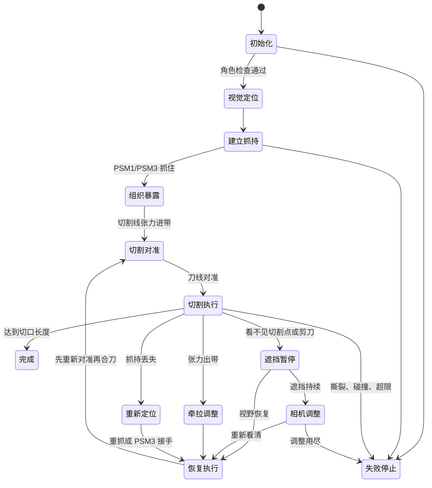
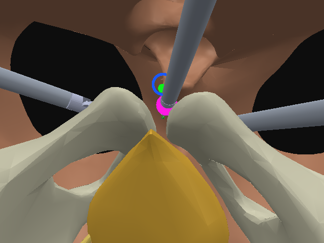

# 达芬奇式多臂手术机器人仿真：前列腺邻近组织切割的多臂协同视觉伺服

这个项目在 CoppeliaSim 里搭了一台达芬奇式多臂手术机器人，从脚端对接到一具成年男性解剖模型上。它包含三条持器械臂（PSM）和一条内窥镜臂（ECM）。四条臂都用软件 RCM 绕腹壁穿刺点运动。系统在内窥镜引导下完成三臂协同任务：牵拉组织、剪开组织、保持视野。


| 臂 | 角色 | 器械（da Vinci Si，8 mm EndoWrist） |
|---|---|---|
| PSM1 | 主牵拉 | 420172 Maryland Bipolar Forceps |
| PSM2 | 切割 | 420179 Monopolar Curved Scissors |
| PSM3 | 辅助牵拉、交接 | 420093 ProGrasp Forceps |
| ECM | 视野保持 | 30° 斜视内窥镜（640×480，水平视角 70°） |

> 这是研究用的运动学仿真，不是临床系统。关节限位、穿刺点规则、组织模型都是探索性的仿真设定，没有和真机或临床数据标定过。

---

## 亮点

- **软件 RCM**：每条臂的器械杆始终穿过固定的腹壁穿刺点。24 秒演示中 RCM 漂移 < 2×10⁻⁹ m，求解失败 0 次。
- **带碰撞保护的控制器**：每个候选姿态提交前，先检查约 2100 对网格的相交。越界或会碰撞的指令被拒绝并回退。
- **按几何认器械，标签无效**：系统从场景里的钳口和腕部网格认出每条臂上装的是什么器械，再按这个器械的能力放行角色。抓钳不能靠改角色名变成剪刀，剪刀也不能去抓东西。
- **可抓、可剪的组织**：基于位置动力学（PBD）的组织片。抓钳能抓住并牵拉它，剪刀合上时剪断两片刀片之间的部分，拉得过紧会撕裂。
- **13 状态任务状态机**：内含监督器，处理遮挡、滑脱、张力异常、视野偏移和故障。离线 15 个场景覆盖了全部状态。在 CoppeliaSim 中，三臂协同切割在正常、短暂遮挡、持续遮挡三种场景下都完成了。
- **穿刺点重新规划**：在体表网格上搜索 PSM1 和 PSM3 的新穿刺点，并求出无碰撞的手臂姿态。

---

## 器械


网格和腕部、钳口几何取自开源的 [jhu-dvrk/dvrk_model](https://github.com/jhu-dvrk/dvrk_model)，使用固定提交（MIT 许可）。腕部和钳口的限位数值取自 [sawIntuitiveResearchKit](https://github.com/jhu-dvrk/sawIntuitiveResearchKit) 的器械文件，只引用了数值。每种器械有一个描述文件 `config/instruments/<型号>.json`，写着它的能力，比如 `grasp`、`grasp_tissue`、`retract_tissue`、`cut`。

安装时还修正了两处：

- **弯剪转轴**：两片刀片网格共用的销孔位于 dVRK 钳口坐标 y = 2.45 mm。dVRK 原 xacro 绕 y = 0 旋转，张开时两个销孔会错开。现在改为绕销孔旋转。
- **ProGrasp 铰点**：按 dVRK 的线性规律，张开时铰点后移，每 rad 钳口约 2.1 mm。场景用一个随 `setGrip` 联动的棱柱关节实现。

**角色检查**：角色在 `config/instruments/roles.json` 里只写“需要哪些能力”。`scripts/build/instrument_guard.py` 只看几何来认器械。在旧场景（三把持针钳）上运行时，三条 PSM 全被拒绝：持针钳没有 `cut` / `retract_tissue`，且与声明的型号不符。

---

## 组织模型与切割


组织片的实现在 `src/tissue/tissue.lua`。它是一张节点网格，节点之间用距离约束相连，有预张力，每步重建成网格形状，所以内窥镜看得见。

| 动作 | 条件 | 效果 |
|---|---|---|
| `tissueGrasp` | 器械有 `grasp_tissue` | 钳口附近的节点跟随钳口 |
| 剪刀合上 | 器械有 `cut`，且刀片先张开 ≥ 0.15 rad | 剪断两片刀片扫过的楔形区里的约束 |
| 约束被拉到 1.5 倍静长 | 任何时候 | 断开，计为撕裂 |

`scripts/tissue/tissue_cut_demo.py` 的检查结果：抓钳开合，剪断 0 个约束；剪刀抓取被拒绝；剪刀张开、前进、合上 4 次后，切口深 10 mm，撕裂 0。

---

## 任务状态机



图中只画了切割执行时的中断。组织暴露、切割对准等状态也会按同样规则中断。

决策都在 `scripts/task/cut_fsm.py` 里，感知和动作由 World 提供。World 有两种：`sim_world.py` 接 CoppeliaSim，`fake_world.py` 是测试用的运动学模型。监督器每拍按优先级检查：

1. 故障或撕裂 → 失败停止。
2. 看不见切割点或剪刀 → 遮挡暂停，所有臂先停住。
3. 抓持丢失 → 重新定位。原来的臂重抓；不行就由 PSM3 接手主牵拉点。
4. 切割线张力出带 → 牵拉调整。
5. 切割点偏离画面中心 → 相机调整。

剪刀合上前会再看一次，看不见就不合。中断的切割一律先重新对准，再合刀。

**离线测试**：在 `scripts/task/` 下运行 `python -m unittest test_cut_fsm`。15 个场景，13 个状态全部到达，共 23 种转移。

**CoppeliaSim 运行**：

| 模式 / 场景 | 状态路径 | 结果 |
|---|---|---|
| 三臂 / 正常 | 定位 → 抓持 → 暴露 → 对准 → 切割 → 完成 | 切口 10 mm，撕裂 0 |
| 三臂 / 短暂遮挡 | … → 遮挡暂停 → 恢复 → … → 完成 | 完成 |
| 三臂 / 持续遮挡 | … → 遮挡暂停 → 相机调整 → 恢复 → … → 完成 | ECM 转 3° 后完成 |
| 只剪（组织两侧固定）/ 上面三种 | 跳过抓持 | 都完成，切口 9 mm |


---

## 穿刺点规划


用原来的穿刺点和家位，PSM1 要摆 7.3° 才够到组织，但它只能摆 ±1°。`scripts/build/plan_psm_ports.py` 在体表网格上为 PSM1 和 PSM3 搜索新穿刺点，PSM2 和 ECM 不动。候选点要满足：离其他穿刺点 ≥ 60 mm，和 PSM2 的杆夹角 25–80°，不挡内窥镜视线，到抓点的直线不碰骨头和器官。然后用逆解求手臂姿态，要求初始位置和任务动作中都没有意外接触。

| 臂 | 穿刺点移动 | 到抓点距离 | 和 PSM2 夹角 |
|---|---|---|---|
| PSM1 | 2.3 mm | 127 mm | 62° |
| PSM3 | 23.4 mm | 148 mm | 31° |

---

## 更早的阶段

| 场景 | 内容 |
|---|---|
| `scenes/davinci_three_arm_rcm.ttt` | 无人体的三臂 RCM |
| `scenes/davinci_foot_docking_rcm.ttt` | 脚端对接、分腿体位、腹壁 RCM（[24 秒演示](docs/foot_docking_rcm_demo.mp4)） |
| `scenes/davinci_endoscope_task.ttt` | 加入 ECM 和 30° 内窥镜，PSM2 用视觉伺服做拾取放置 |
| `scenes/davinci_si_instruments.ttt` | **当前**：Si 器械、组织模型、新穿刺点、任务状态机 |

内窥镜场景的视觉伺服（PBVS）跑了 6 次，全部成功：1 次标称，5 次加入相机位姿误差 2° + 3 mm 和深度噪声 σ = 0.5 mm。珠子到目标环中心的真值误差为 0.18–0.58 mm。



各阶段的详细说明、验证数据和已知问题见 [docs/DETAILS_zh.md](docs/DETAILS_zh.md)。

---

## 快速开始

**只看场景**：用 CoppeliaSim Edu 4.10 打开 `scenes/davinci_si_instruments.ttt`，点播放。场景自带网格和 Lua 控制器，不需要 Python。RCM 面板可以选臂，调 yaw、pitch、insertion 和钳口开合。

**运行任务和检查**：需要一个专用的 CoppeliaSim 实例，端口不要与其他实例重复。

```powershell
python -m pip install -r requirements-build.txt
& "C:\Program Files\CoppeliaRobotics\CoppeliaSimEdu\coppeliaSim.exe" -h -GzmqRemoteApi.rpcPort=23170

cd scripts/task
python -m unittest test_cut_fsm                                                # 离线状态机测试
python run_cut_task.py --port 23170 --mode full --scenario nominal --sheet     # 三臂协同切割
python run_cut_task.py --port 23170 --mode full --scenario occlusion_persistent --sheet
python ../tissue/tissue_cut_demo.py --port 23170                               # 组织抓取与剪切检查
python ../build/instrument_guard.py --port 23170 --scene ../../scenes/davinci_si_instruments.ttt --out check.json
```

CoppeliaSim 4.10 的 Remote API 处理不了中文路径。场景文件会先复制到一个 ASCII 临时目录再加载，可以用 `--stage-dir` 指定这个目录。

**重建当前场景**：

```powershell
cd scripts/build
python fetch_dvrk_instruments.py               # dVRK 器械网格（已提交，可跳过）
python install_instruments.py --port 23170     # 内窥镜场景 → Si 器械场景；应用 config/instruments/port_plan.json
python plan_psm_ports.py --port 23170          # 重新规划 PSM1/PSM3 穿刺点（读取当前器械场景）
python install_instruments.py --port 23170     # 应用新计划后再装一次
```

内窥镜场景本身的重建步骤见 [docs/DETAILS_zh.md](docs/DETAILS_zh.md)。

---

## 目录

| 路径 | 内容 |
|---|---|
| `scenes/` | CoppeliaSim 场景 |
| `src/` | 场景内 Lua：RCM 控制器、面板、能力检查、组织模型 |
| `scripts/build/` | 场景构建、穿刺点和对接规划、器械识别、渲染 |
| `scripts/task/` | 任务状态机、World 适配器、测试、运行入口 |
| `scripts/vision/` | 内窥镜视觉伺服拾取放置 |
| `config/` | RCM、碰撞对、器械描述、角色、穿刺点计划、任务阈值 |
| `models/` | URDF、CAD 与器械网格、BodyParts3D 解剖模型 |
| `validation/` | 每一步的验证记录（JSON、PNG） |
| `docs/` | 图片、视频、详细说明 |

---

## 局限

- 关节限位、穿刺点规则和任务阈值都是仿真设定，没有和真机标定过。软件 RCM 用的是 CAD 等效的串联链，不是真实的闭链机构。
- 组织是运动学片：没有质量、重力、接触力、出血。器械不和组织碰撞。组织片是放在剪刀前面的测试片，不是解剖结构。
- 解剖模型是静态的：没有气腹、器官形变和呼吸。
- 切割长度来自组织约束，不是视觉测量。能量器械（单极、双极）不仿真。
- 穿刺点只按一个工作区规划，不是整个前列腺周围的工作空间。

---

## 数据来源与署名

- 解剖模型：BodyParts3D, © The Database Center for Life Science, licensed under CC Attribution 4.0 International（[许可](https://dbarchive.biosciencedbc.jp/en/bodyparts3d/lic.html) · [下载](https://dbarchive.biosciencedbc.jp/en/bodyparts3d/download.html)）。使用了官方 `isa_BP3D_4.0_obj_99.zip` 中选出的模型，做了单位换算、体位调整、体表筛选和分腿姿态处理。
- 器械网格：[jhu-dvrk/dvrk_model](https://github.com/jhu-dvrk/dvrk_model)，MIT，许可副本在 `models/meshes/instrument/dvrk/LICENSE`。
- 器械限位数值：[jhu-dvrk/sawIntuitiveResearchKit](https://github.com/jhu-dvrk/sawIntuitiveResearchKit)，cisst 许可。只引用了数值，未复制文件。
- 机器人 CAD 和原持针钳：用户提供的项目资产，许可与上面几项分开处理。
