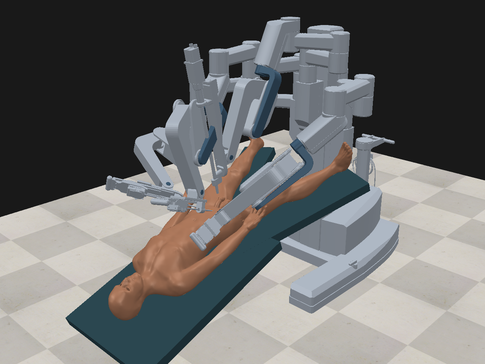

# 达芬奇式多臂机器人：脚端对接与腹壁 RCM 仿真

最新场景包含三条持针钳器械臂、CAD 镜臂、BodyParts3D 成年男性及分段手术台。患者采用头低脚高 20°、每侧分腿 20° 的静态示意姿态，机器人从脚端中央对接。




[24 秒双视图演示](docs/foot_docking_rcm_demo.mp4) · [无遮挡腿部检查](docs/leg_fix_top.png) · [详细验证报告](docs/foot_docking_validation_zh.txt)

## 直接打开

1. 使用 CoppeliaSim Edu 4.10 打开 [scenes/davinci_foot_docking_rcm.ttt](scenes/davinci_foot_docking_rcm.ttt)。场景自包含网格与 Lua 控制器，不需要 Python、ROS 或 MATLAB。
2. 点击播放：循环演示摆动、插入、组合运动。橙色圆环为固定腹壁 RCM 点。
3. 使用 RCM 面板选择器械臂并调整 yaw、pitch、insertion；越界或碰撞请求会被拒绝并回退。
4. 人体面板可切换 Whole body、透明体表、盆腔和隐藏骨盆视图。Whole body 已修复为可见且完全不透明。

## 本次验证范围

| 项目 | 结果 |
|---|---|
| 摆动范围 | yaw ±1°、pitch ±0.75° |
| 插入关节范围 | 38–42 mm，中位 40 mm |
| 连续周期 | 24 秒，481 个控制步 |
| 求解失败 / 演示碰撞回退 | 0 / 0 |
| 最大 RCM 数值残差 | 约 0.000019 mm，不代表实机精度 |
| 独立网格相交抽检 | 49 次 × 2046 对网格，无意外相交 |
| 手动边界目标 | 24/24 通过 |
| 障碍注入测试 | 拒绝运动、精确回退，测试障碍已恢复 |
| 器械尖端距前列腺表面 | 约 20–29 mm，为周围接近区域，尚未接触组织 |

控制器在候选姿态提交前检查相关碰撞对。只允许器械长杆在各自腹壁 RCM 点 16 mm 半径内的预期体表穿越，不忽略整个人体碰撞对。相邻装配面、闭合夹爪及内部腕部配合面不属于意外碰撞。检查基于三角网格表面相交，不等同于连续扫掠、实体包含检测或接触力求解。

## 模型边界

- 这是 CAD 等效串联关节链的软件 RCM；真实闭链传动、机械 RCM 耦合与厂商限位尚未标定。
- 为脚端对接调整了探索性仿真关节范围：setup/mount 为 ±π，shoulder/elbow/carrier 为 ±1.2 rad；PSM1 升降 −0.06..0.35 m，PSM2/3 为 −0.06..0.25 m。**这些范围不是已验证的实机行程。**
- 腿部姿态是静态体表处理，不是肌骨关节或软组织仿真。腹壁与盆腔器官位置未单独调整。
- 摄像孔是规划标记；ECM 尚未加入此次腹壁 RCM 控制。
- 尚无组织变形、气腹、牵拉、缝线、切割或临床入路验证。扩大摆动范围曾出现髋骨相交，不能把本次局部通过结果推广到整个工作空间。

## 文件与复现

- `scenes/davinci_foot_docking_rcm.ttt`：当前推荐场景。
- `models/davinci_foot_docking.urdf` + `models/meshes/`：同步后的机器人模型；URDF 保留 CAD 零位，须应用 `config/home_joint_positions.json` 才是本次对接姿态。
- `models/anatomy/`：原始选定器官 OBJ、修复后的体表 NPZ、来源与许可副本。
- `config/`：最新穿刺点、初始关节位置、姿态及碰撞对。
- `src/rcm_guarded_embedded.lua`：场景使用的完整受限位与碰撞保护控制器；其余 Lua 为基础求解器和面板。
- `validation/foot_docking/`：最新运动、腿形、控制、视频及可见窗口验证记录。
- `validation/latest_asset_checksums.json`：本次资产 SHA-256 与大小。
- `scripts/authoring/`：本机作者脚本，包含原工作区路径和开发端口；不是开箱即用的跨平台构建命令。使用场景无需运行它们。

独立读取运行中的 RCM 残差：

```bash
python -m pip install -r requirements.txt
python scripts/verify_rcm.py --port 23000 --samples 100 --out runtime_validation.json
```

端口需与 CoppeliaSim ZeroMQ Remote API 一致。默认使用新版 `config/rcm_config.json`。

旧版无人体的 [davinci_three_arm_rcm.ttt](scenes/davinci_three_arm_rcm.ttt) 仍保留，验证时传 `--config config/legacy_rcm_config.json`。旧版源码在 `src/legacy/`，早期验证在 `validation/` 根目录；它们不代表当前解剖注册版本。

## 内窥镜与视觉闭环场景（开发中）

[scenes/davinci_endoscope_task.ttt](scenes/davinci_endoscope_task.ttt) 在上面的推荐场景基础上加入了 ECM 软件 RCM、30° 斜视内窥镜相机，以及一个由内窥镜引导、PSM2 完成的拾取放置任务。基础场景文件未被修改。

- **ECM**：镜杆穿过 `PlannedCameraPort`，7 个旋转关节保持镜杆位置、方向和图像滚转；手动范围 yaw/pitch ±6°，插入 70–90 mm。PSM 演示时 ECM 保持不动。
- **内窥镜相机** `EndoscopeCamera`：640×480，水平视场 70°，裁剪面 2–300 mm，图像上方对应患者腹侧。面板中的 “Show endoscope view” 打开浮动视图；“Open/Close jaws” 控制所选 PSM 的夹爪。
- **PSM2 重新摆位**：在零空间内调整手臂，器械位姿不变；摆位同时满足 ECM 和 PSM2 在各自运动范围角点上互不相交。关节变化见 `config/endoscope/ecm_plan.json`。
- **任务物体**（`config/endoscope/task.json`）：绿色珠子 `TaskBead`（直径 5 mm）、蓝色目标环 `TaskTarget`（半径 5 mm）、PSM2 腕部品红标记球 `psm2_TipMarker`（半径 6 mm）。物体放在 PSM2 回撤后能进入、且内窥镜中无遮挡的骨盆上方空腔内，两者相距 12.5 mm。它们是无重力、无接触力的静态夹具，抓取通过把珠子挂到夹爪尖端坐标系实现。
- **探索性限位，不是实机行程**：
  - ECM：setup/mount ±π，shoulder/elbow/carrier ±1.6 rad，升降 −0.20..0.25 m，插入 −0.03..0.10 m。
  - PSM2 手动范围：yaw/pitch ±5°，插入 0–45 mm（自动演示幅度仍为 ±1°/±0.75°/±2 mm）。

### 视觉闭环

`scripts/vision/visual_servo_task.py` 只使用内窥镜 RGB 图、仿真深度缓冲和相机内参：

- **感知**：按颜色分割，把深度反投影成三维点。珠子和标记球用已知半径做球拟合，目标环用平面加圆拟合。
- **控制**：基于位置的视觉伺服（PBVS）。在相机坐标系计算误差，积分到夹爪抓取点的目标位置，再按固定 RCM 几何换算成 yaw/pitch/insertion，交给场景内带碰撞保护的 RCM 控制器执行。
- **流程**：一条开环指令把器械带入视野，之后全部由视觉驱动：预抓取 → 抓取 → 夹紧并挂接 → 抬起 → 预放置 → 放置 → 松开 → 回撤。
- **真值的用途**：只用于日志记录和最终成功判定。

本次结果（`validation/endoscope/visual_task_summary.json`）：6 次运行全部成功，其中 1 次标称，5 次加入相机位姿误差 2°+3 mm 与深度噪声 σ=0.5 mm。最终珠子到目标环中心的真值误差为 0.18–0.58 mm。指令拒绝和意外相交均为 0，PSM2 RCM 残差小于 1e-7 m。

### 重建与回归（需要一个专用的 CoppeliaSim 实例）

```powershell
python -m pip install -r requirements-build.txt
# 启动专用实例，端口不要与其他实例重复
& "C:\Program Files\CoppeliaRobotics\CoppeliaSimEdu\coppeliaSim.exe" -h -GzmqRemoteApi.rpcPort=23170
cd scripts
python build/plan_ecm_docking.py --port 23170 --only 0.14,-60  # ECM + PSM2 对接 → config/endoscope/ecm_plan.json（约 3.5 分钟）
Remove-Item ../config/endoscope/task.json -ErrorAction SilentlyContinue
python build/build_endoscope_scene.py --port 23170             # 先建不含任务物体的场景
python build/plan_visual_task.py --port 23170                  # 选取可见且可达的拾取/放置点 → config/endoscope/task.json
python build/build_endoscope_scene.py --port 23170             # 加入任务物体后重建
python build/validate_endoscope_scene.py --port 23170          # 场景回归 → validation/endoscope/scene_validation.json
python vision/run_visual_task_suite.py --port 23170            # 视觉闭环 6 次运行 → validation/endoscope/visual_task_*.json
# 独立读取运行中四臂（含 ECM）的 RCM 残差
python verify_rcm.py --port 23170 --start --config ../config/endoscope/rcm_config.json
```

单一事实来源是 `src/endoscope/*.lua` 与 `config/endoscope/endoscope.json`。场景内嵌脚本由构建脚本生成，回归脚本会检查内嵌文本与源文件是否逐字一致。场景文件经 ASCII 临时目录中转，因为 CoppeliaSim 4.10 的 Remote API 无法处理中文路径。

### 已知限制

- 静态解剖：在对接插入深度下，PSM1/PSM3 尖端被骨盆遮挡，前列腺被膀胱和耻骨完全遮挡。任务因此放在可见空腔内，而不是前列腺上。
- 拾取放置是运动学示意：没有重力、接触力、组织形变；腕部标记球是仿真用的视觉标记。
- 被夹持的珠子由独立扫描检查是否与解剖结构相交；运行时碰撞保护只覆盖珠子与 PSM2 器械杆、其他臂的组合，不检查珠子与夹爪之间。
- 相机位姿来自 ECM 运动学；鲁棒性测试只注入了上述固定幅度的误差，没有做标定流程。

基础场景中发现的问题：PSM2 的 mount/shoulder 在 ECM 停放位已与 ECM 网格相交，原碰撞对没有覆盖这类组合；`config/collision_pairs.json` 中有 280 对重复。新场景的碰撞对已去重，并补齐了全部 ECM 与任务物体相关组合。

## da Vinci Si 器械场景（开发中）

[scenes/davinci_si_instruments.ttt](scenes/davinci_si_instruments.ttt) 在内窥镜场景上按 `config/instruments/roles.json` 换装 Si 器械。内窥镜场景文件未被修改。


| 臂 | 角色 | 器械 | 能力 |
|---|---|---|---|
| PSM1 | 主牵拉 | 420172 Maryland Bipolar Forceps | grasp, grasp_tissue, retract_tissue, bipolar_energy, blunt_dissection |
| PSM2 | 切割 | 420179 Monopolar Curved Scissors | cut, monopolar_energy, blunt_dissection |
| PSM3 | 辅助牵拉、交接 | 420093 ProGrasp Forceps | grasp, grasp_tissue, retract_tissue |
| ECM | 视野保持 | 30° 内窥镜相机 | view |

- **来源**：网格和腕部/钳口几何来自 [jhu-dvrk/dvrk_model](https://github.com/jhu-dvrk/dvrk_model)（MIT，固定提交，副本与 `SOURCE.json` 在 `models/meshes/instrument/dvrk/`）。限位数值来自 [sawIntuitiveResearchKit](https://github.com/jhu-dvrk/sawIntuitiveResearchKit) 的器械文件（cisst 许可，只引用数值，未复制文件）。描述文件在 `config/instruments/<型号>.json`。
- **能力不靠标签**：`scripts/build/instrument_guard.py` 从场景的关节轴和钳口、腕部网格识别每条臂上的器械（与各候选器械的表面平均距离，阈值 0.5 mm），再查该器械的能力。角色只“要求”能力。`roles.json` 里写的型号与几何不符时，这条臂被拒绝。场景控制器追加 `src/instruments/capability_guard.lua`：没有 `grasp` 能力的器械调用 `grasp` 会被拒绝。
- **器械长度**：原脚本写死的 `tcp_len = 0.4498` 改为从场景读取（joint8 到 tcp 的轴向距离）。换装后为 PSM1 0.4619、PSM2 0.4523、PSM3 0.4695 m。tcp 取钳口网格的几何尖端；dVRK 的 tool tip 只记录在 `install_manifest.json`（差 0.16–4.0 mm）。
- **剪刀转轴**：`scripts/build/measure_jaw_pivot.py` 在两片刀片网格里找到共用的销孔，位于 dVRK 钳口坐标 y = 2.45 mm。dVRK xacro 绕 y = 0 旋转，张开 1 rad 时两个销孔会分开 2.4 mm。场景改为绕销孔旋转，刀片位置不变。同样方法在持针钳 006 上找到的销孔在 y = 0。
- **ProGrasp 铰点**：加了棱柱关节 `psm3_jaw_hinge_slide`。`setGrip` 按 dVRK 的线性规律移动铰点（每 rad 钳口 −2.1 mm，限 0–60°）。
- **PSM1 张口**：PSM1 器械绕自身杆转 45°（joint8），钳口张开 1.0 rad 不再碰左髋骨。杆、RCM 点和尖端位置不变。安装脚本以 5° 步长搜索最近的可行转角。dVRK 的 `D = 0.4670` 是从 dVRK 自己的滚转坐标原点量起，与本场景的 joint8 原点不是同一个参考点，所以不能直接替换。杆长保持原 CAD 值。

验证（`validation/instruments/`）：

| 项目 | 结果 |
|---|---|
| 坐标对齐（dVRK 腕部系与场景关节轴） | 轴向误差 3e-7 |
| 原持针钳与 dVRK Si 420006 的表面距离 | 钳口约 0.44–0.50 mm，腕部 0.66 mm（原网格是 Classic 风格，另存为 `legacy_lnd` 参考） |
| 换装后识别 | 三臂全部正确，与第二候选相差 0.68–1.40 mm |
| 回家位碰撞（钳口闭合 / 张开 1.0 rad） | 0 / 0（PSM1 转 45° 后） |
| ProGrasp 铰点 | 张开 1.0 rad 时后移 2.1 mm，闭合回 0 |
| 24 秒演示周期 | 求解失败 0，碰撞回退 0，RCM 漂移 < 2e-9 m |
| 运行时抓取 | PSM1、PSM3 接受；PSM2 剪刀拒绝 |
| 角色检查 | 新场景通过；内窥镜场景三条 PSM 全部拒绝（原持针钳没有 cut / retract_tissue，且与声明型号不符） |
| 视觉拾取放置回归（内窥镜场景） | 结果不变，0.378 mm；在新场景上 PSM2 因没有 grasp 能力被拒绝运行 |

重建：

```powershell
cd scripts/build
python fetch_dvrk_instruments.py                     # 下载固定提交的 dVRK 网格（已提交，可跳过）
python install_instruments.py --port 23170           # 生成 scenes/davinci_si_instruments.ttt 与 install_manifest.json
python instrument_guard.py --port 23170 --scene ../../scenes/davinci_si_instruments.ttt --out ../../validation/instruments/capability_check_si_instruments.json
python render_instrument_tips.py --port 23170        # docs/si_instrument_tips.png
python measure_jaw_pivot.py 420179                   # 剪刀销孔位置（不需要 CoppeliaSim，需要 shapely）
python ../tissue/tissue_cut_demo.py --port 23170     # 组织抓取与剪切检查
```

已知限制：

- 钳口只有两个关节（joint10/11），腕部偏航不单独驱动。0107 腕部的偏航夹头固定在腕部上。
- 剪刀转轴来自网格测量，不是厂商图纸。tcp 用几何尖端，与 dVRK 的运动学 tool tip 不同。
- 能量器械（单极、双极）不仿真。
- 不可见的碰撞外壳改为新网格的凸包；碰撞检查仍用可见网格。

### 组织模型（开始阶段）

`src/tissue/tissue.lua` 追加在场景控制器里：节点网格加距离约束（位置动力学），两边和远端固定、预张 8%，每步重建成网格形状，内窥镜可见。

- `tissueGrasp(臂)` 需要 `grasp_tissue`：钳口附近 1.5 mm 内的节点跟随尖端。
- 剪刀（`cut`）从张开（≥ 0.15 rad）合上时，剪断离刀线（销孔到尖端）0.3 mm 内的约束。抓钳合上不剪。
- 约束拉长到 1.5 倍静长时断裂，记为撕裂。


`scripts/tissue/tissue_cut_demo.py`（结果 `validation/tissue/cut_demo.json`）：

| 检查 | 结果 |
|---|---|
| PSM1 抓钳开合 | 剪断 0 |
| PSM1 抓取并后拉 1.5 mm | 抓住 84 个节点，最大应变 0.09 → 0.27，撕裂 0 |
| PSM2 剪刀抓取 | 拒绝 |
| PSM2 张开-前进 3 mm-合上 ×4 | 剪断 66 个约束，切口深 10 mm，切口宽 1.4–2.5 mm，撕裂 0 |

限制：组织是运动学片，器械不和它碰撞；没有质量、重力、接触力、出血。组织片是放在 PSM2 前面的测试片，不是解剖结构。第一次试验中，近端角上固定的节点在剪切前就撕裂了，所以侧边固定从第 1 行开始。

## 数据来源与署名

BodyParts3D, © The Database Center for Life Science licensed under CC Attribution 4.0 International.

[官方许可页](https://dbarchive.biosciencedbc.jp/en/bodyparts3d/lic.html) · [官方数据下载](https://dbarchive.biosciencedbc.jp/en/bodyparts3d/download.html)

使用官方 `isa_BP3D_4.0_obj_99.zip` 中选定的模型。原始 OBJ 头部含历史许可文字；当前官方许可页副本保存在 `models/anatomy/source_LICENSE_source.html`。修改包括毫米转米、刚体体位、外体表筛选、分腿姿态、着色与仿真层级。CAD 和持针钳来自用户提供的项目资产，其许可与 BodyParts3D 分开处理。
