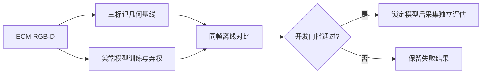
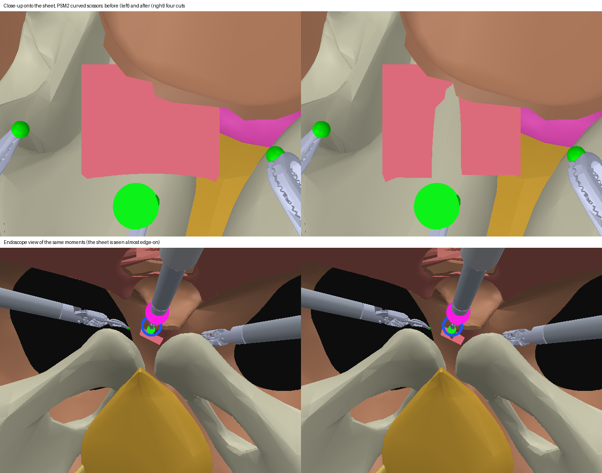
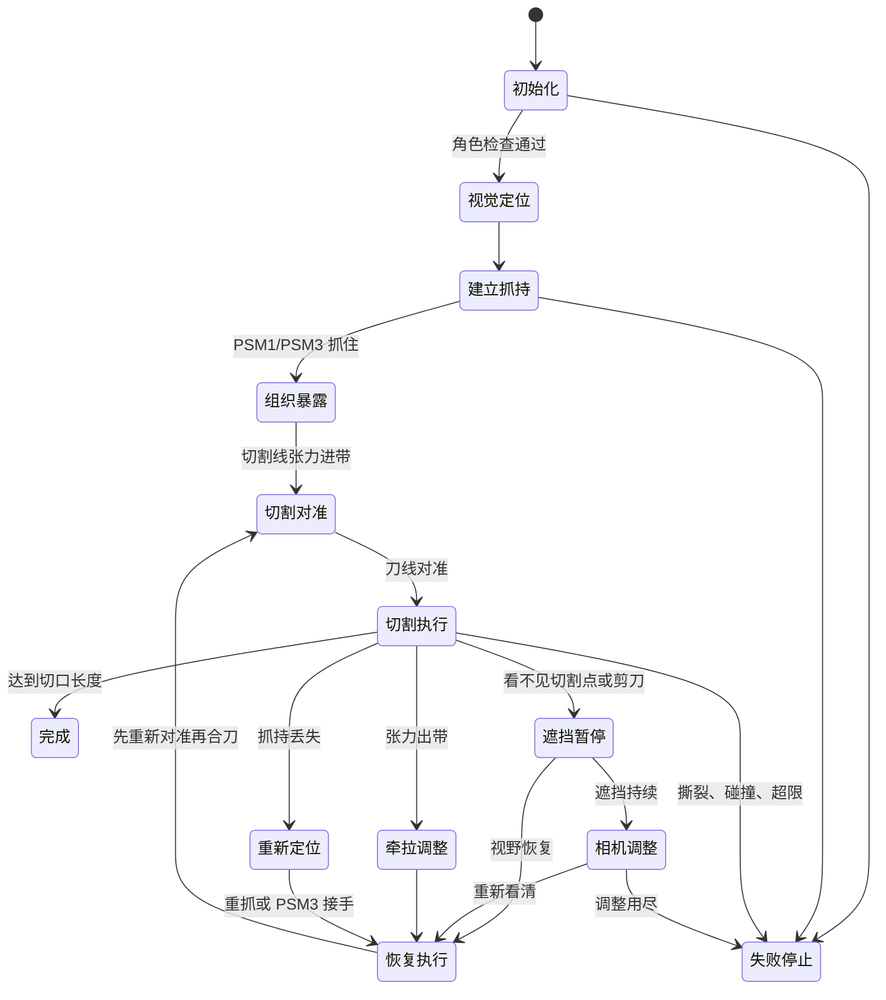
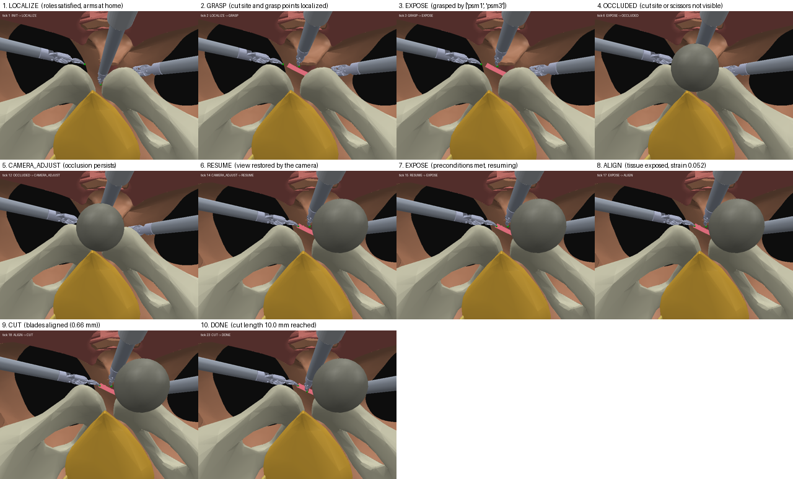

# 达芬奇式多臂手术机器人仿真：多臂协同视觉伺服切割（研究仿真）

> **2026-11-24 进度：** 严格视觉停刀仍未通过；剪刀尖端 RGB-D 离线训练方案已冻结，尚未执行。现行场景是 `scenes/davinci_si_articulated_verified.ttt`。旧场景与早期演示保留，不代表当前版本验收。

这个 CoppeliaSim 研究基准包含三条持器械臂（PSM）和一条内窥镜臂（ECM），使用软件 RCM、可动腕部和带守卫的任务状态机。切割目标是仿真中的**非解剖测试片**；场景背景不构成解剖定位或临床有效性的证据。


| 臂 | 角色 | 器械（da Vinci Si，8 mm EndoWrist） |
|---|---|---|
| PSM1 | 主牵拉 | 420172 Maryland Bipolar Forceps |
| PSM2 | 切割 | 420179 Monopolar Curved Scissors |
| PSM3 | 辅助牵拉、交接 | 420093 ProGrasp Forceps |
| ECM | 视野保持 | 30° 斜视内窥镜（640×480，水平视角 70°） |

> 这是研究用的运动学仿真，不是临床系统。关节限位、穿刺点规则、组织模型都是探索性的仿真设定，没有和真机或临床数据标定过。

---

## 最新进展：从视觉停刀诊断到尖端定位

| 方向 | 当前状态 | 结果与证据 |
|---|---|---|
| RGB-D 数据采集 | Phase A 完成 | **300 条开发轨迹 / 35,046 帧**（含高清及辅助视角），248 完成、52 失败；均为**真值控制**，失败未剔除。[采集报告](validation/task/learned_perception_v1/dev.json) |
| 严格 M5 视觉停刀 | 未通过，暂不扩采 | 原生高清在新开发队列首次达到 9/10 mm 时 **0/18** 检出；同口闭合后的 3 mm 回看中，9 张图均弃权。[高清配对结果](validation/task/learned_perception_v1/phase_a_native_hd_eval_v1.json) · [闭合回看结果](validation/task/learned_perception_v1/phase_a_closed_look_eval_v1.json) |
| 剪刀尖端定位 | **方案已冻结；待跑基线和训练** | 659 张抽查帧中，635 张满足标记与深度证据筛选，24 张尖端受挡。按轨迹冻结 **270 训练 / 30 验证 / 64 预留独立评估**；独立集尚未采集。[方案](config/learn/learned_tip_v1.json) · [轨迹与种子](config/learn/learned_tip_v1_episodes.json) |
| 可见切口前沿 | 暂缓训练 | 切后 295 张通过粗深度筛选，其中 92 张缺双侧几何支撑；通过几何筛选也不等于能辨认裂缝末端。[标注抽查](validation/task/learned_perception_v1/keypoint_annotation_audit_v1.json) · [人工复核](validation/task/learned_perception_v1/keypoint_visual_spotcheck_v1.json) |


*同一开发回合的两张实际 640×480 ECM 图像局部，等比例放大，无真值叠图。左：TCP 投影通过图像证据筛选；右：前景球挡住尖端，仍有刀杆标记可见。不能根据标记可见就宣称尖端无遮挡。*



模型不读取仿真真值、帧序号或运动状态。真值只用于标签与离线评分。原始数据集、缓存和权重不入 Git；仓库保留方案、清单、报告及少量说明图。**当前没有新的 M5、M6 或 M7 验收，也没有将模型接入控制。** 复现入口：[M5 端点记录](docs/M5_ENDPOINT.md) · [M5 实跑记录与复现命令](docs/M5_LIVE_DEVELOPMENT.md) · [阶段路线图](docs/DEVELOPMENT_ROADMAP_zh.md) · [学习环境依赖](requirements-learn.txt)。

---

## 历史进展：M5 端点与光学开发（截至 2026-11-20）

**当前主任务是视觉自主停刀并撤回，尚未通过。** 目标是机器人从未切状态出发，每刀都由当前 RGB-D 引导，在实际结构切长 9–10 mm 时自行决定撤刀；不是数刀数，也不是真值控制。最近的完整视觉尝试在标称和 0.5 mm 噪声下均停在 5 mm。

**四步计划：第 1 步完成，第 2 步已补齐同印色广角样本，但读数未过关；未进入第 3、4 步。** 修过的 `cell_certificate` 从同侧印色边界定位可见角点，区分“局部前沿”和“入口到前沿连续剪通”。在实际 20° 闭刀回退图上，8、9、10 mm 的局部读数首次在原始和加噪深度下全部正确；入口仍被挡住，三张都没有报告可停刀。见[工作位/回退位对照图](validation/task/cell_certificate_v2_dev/working_vs_look.png)及[盲读结果](validation/task/cell_certificate_v2_dev/decision.json)。随后在 **70°、1280×960** 采了同款角标测试片的 0 mm 加载/牵拉和 3、6、8、9、10 mm 各一对工作/回退图：十张切后图均未给出局部切长。8、9、10 mm 的六张广角图中，单个角标最多只有 **1 个可辨色像素**。两种光学的六个检查点逐一核对，测试片节点、剪刀位姿和原始参考帧相同，不是另一刀剪出了不同结果。[广角判定](validation/task/cell_certificate_v2_hd_dev/decision.json) · [匹配和像素数](validation/task/cell_certificate_v2_hd_dev/sampling_diagnostic.json)。

**当前入口：[M5 运行与判定边界](docs/M5_ENDPOINT.md)。** 主控制器现在核验两片刀的实际闭合和归位误差；中央表面切缝、滑动导向和固定印色可在同一夹具配置启用，不再逐层改写 Lua。原片真值基线仍为 10 mm，[17 帧节点轨迹与历史一致](validation/task/m5_local_hd_dev_v1/truth_reference_check.json)。修正读尺行号后，合成 8/9/10 mm 能分开；但 [70°、1280×960 实拍开发盲读](validation/task/m5_local_hd_dev_v1/decision.json) 未过：三条真值轨迹实际剪至 8/9/10 mm 并闭刀归位，9 张切后工作图和 3 张闭刀回退图均未能读出局部切长，原始和加噪深度结果相同。尤其是 10 mm 回退时，[第十格的一个已断三角面在投影内没有一个像素中心](validation/task/m5_local_hd_dev_v1/terminal_rays.json)。不把分辨率翻倍当作解决方案。未使用独立确认集，未将读数接入视觉闭环。

**此前：修正模型应变后，能抓、能剪、能撤，仍不能凭视觉决定停刀。** 测试片中央横向连接由 1 mm 改为 3 mm 后，旧公式仍用 1 mm 网格归一化；新小样直接读各行弹簧的静息长度（2.76 mm）。同一布置在抓持后的应变从误报的 2.054 变为 0.018，两臂各向外拉约 0.20 mm，无撕裂。约束边缘翘起后，20° 实际成像下的未切、只牵拉两张图均能识别全部 28 个角标、26 个完整面。六条**真值控制**开发轨迹有实际 8、9、10 mm 并闭合撤回；20 张闭剪工作图的盲读仍全为 UNKNOWN。另从三个配对检查点闭刀后退 3 mm，三者仍不能停刀。对能看见三个角标的已断面，保留实测深度、只在事后给出精确二维角点，32/32 出现所需的穿透像素块；反过来只给精确顶点深度是 0/32。这个诊断不能给控制器答案。独立确认未启用。[实图](validation/task/seam_rim_look_v1/work_vs_look.png) · [盲读与逐面归因](validation/task/seam_rim_look_v1/decision.json) · [真实 8/9/10 mm 对照](validation/task/seam_rim_near_v1/decision.json)。

**滑动导向小样：工作位仍不能自主停刀。** 保留原入口、抓点和剪刀路径后，真实四倍分辨率能看到左右终段刻度；五条真值采集轨迹均通过机械和撤回检查，但冻结的读尺程序对 18 张闭剪后工作图全部拒绝（原始深度和 0.5 mm 噪声）。在真正的 8/9 mm 状态各闭刀后退 3 mm，第 9 条刻线呈现不同的裂缝证据，剪刀仍未到停放位。实际 8 mm 时尚存的中央半片，在工作位只能提供 2 个相连的新增墨色像素，后退后有 24 个（只计深度完全未变的像素）。9 mm 时看不见该墨色不能单独证明剪够。连续裂缝候选在完整剪开 9 行的合成对照上误判为未到，不得用于控制。独立确认、视觉闭环和用户验收均未启动或改变。[工作位与观察位](validation/task/seam_work_observability_v1/work_and_backoff.png) · [实测与限制](validation/task/seam_work_observability_v1/decision.json) · [合成反例](validation/task/seam_connected_evidence_v1/decision.json)。

**单层中央切割带小样（2026-11-22）**：保留原入口和抓点，只让仍有片面支撑的中央连接传递牵拉；未切时没有预制裂口。五条真值采集轨迹都能剪开、闭合撤刀；单独的只牵拉对照没有剪开。原镜位的 18 张闭剪后工作图，在原始深度和 0.5 mm 噪声下全部无法判读，包括实际 8 mm 和 9 mm 的工作位对照。事后按片面追踪视线，在一张 8 mm 状态中，第 8 行本身遮住了左侧第 9 行的大部分采样点；移开剪刀不能单独解决这个镜位的问题。[工作图](validation/task/surface_seam_pilot_v1/working_pair.png) · [独立机械评分及盲读](validation/task/surface_seam_pilot_v1/decision.json) · [视线诊断](validation/task/surface_seam_pilot_v1/first_hits.json)。未启用独立确认集，未接入视觉控制，不是 M5b 完成。

**刻度测试片实测**：新增印花只改变原三角面的颜色，不改变切割模型。开发集和单独补采中，实际切至 7、8、9、10 mm 的撤刀帧各两张。冻结读尺程序对这八张图在原始深度及 0.5 mm 噪声下全部拒绝判定；没有接入闭剪或停刀控制。两种合法镜位、真实 2560×1920 采集也没有在 8/10 mm 对照上同时核实切口两侧的局部刻度。看实际图：[8/9/10 mm 裁切对照](validation/task/ruler_v1_actual_8_9_10.png)、[原始与高分辨率对照](validation/task/ruler_optics_v1_comparison.png)。评分与拒绝原因：`validation/task/ruler_v1_threshold_development.json`、`validation/task/ruler_optics_v1_summary.json`。真值采集不是视觉成功；独立确认轨迹仍未启用。

两种新夹具也做了真值可行性检查。绕测试片中线倾斜 45° / 60° 时，四次都未定位到入口；改为绕原入口倾斜 45° 后，入口可见，两臂均抓住，但剪刀未对准。冻结首个对准状态试了九个求解起点，都返回“杆部逆解或碰撞拒绝”，没有实际下剪。不能据此断言所有安装位都不可行。**结论：下一步应在改控制器前，联合验证镜头能看见两条终段刻度、剪刀同时有合法工作路径；只满足其中一项不够。** 汇总：`validation/task/ruler_endpoint_v1_decision.json`。306 项离线回归通过，不能替代视觉实跑验收。

**已完成的单独任务：「两刀后收刀」**。两次闭剪前都必须看清；每刀后都要重新看到新切口，第二刀后闭合撤回起始位。模拟器事后按测试片结构逐刀评分，不用真实切长决定何时收刀。它**不代替**下方 M5b 的 9–10 mm 自主停刀验收。

| 两刀任务的实跑 | 结果 |
|---|---|
| 标称 / 0.5 mm 深度噪声 | 均实际增长 3 + 2 mm，均两次重获并收刀；未撕裂，无 RCM 故障。 |
| 推进后完全盖住相机输入 | 三次换镜仍看不见，未闭剪，实际增长 0 mm。是拒剪对照通过，不是切割成功。 |
| 第一刀后放置局部遮挡物，比较四种策略 | 同一初态下，两个允许换镜的策略均完成第二刀；两个固定镜头的策略均停在 3 mm。 |
| 第一刀后两侧抓持各向内松 0.5 mm | 四组均停在 3 mm；失去可靠的前沿坐标，恢复预算耗尽，未发出自适应牵拉请求。不能据此判断牵拉是否有效。 |

协议和完整结果：`config/task/two_bite_v1.json`、`validation/task/two_bite_v1_verified_summary.json`、`config/task/two_bite_pair_v1.json`、`validation/task/two_bite_pair_v1_summary.json`。后一组是**单一种子的八次配对试跑**，不是多种子结论。300 项离线回归报告：`validation/safety/regressions_two_bite_v1.json`。

复现：使用已启动的**专用** CoppeliaSim 实例，准备已存在的 ASCII 暂存目录；每次选新的输出文件。下例运行一组标称和一组局部遮挡实验（PowerShell）。

```powershell
.\.venv\Scripts\python.exe scripts/task/run_two_bite.py --case nominal --port 23000 --stage-dir C:/Temp --out validation/task/my_two_bite_nominal.json
.\.venv\Scripts\python.exe scripts/task/run_two_bite_pair.py --disturbance view --strategy camera --port 23000 --stage-dir C:/Temp --out validation/task/my_view_camera.json
```

两刀入口的另外两种工况是 `noise` 和 `blocked`。配对入口以已核验的标称原始报告校验配置和源码，工况为 `view` / `creep`，策略为 `fixed` / `camera` / `traction` / `both`。`DONE` 只表示控制器结束，是否通过以独立评分为准。下方保留原严格任务的发展记录。

**目标**：在现有场景 `scenes/davinci_si_articulated_verified.ttt` 上做一个可复现、有安全防护、由视觉驱动的多臂切割基准：三条 PSM（PSM1 主牵拉、PSM2 切割、PSM3 辅助牵拉）加 ECM。路线是 M5 视觉闭环切割，M6 多臂协同（按视觉张力代理牵拉、内窥镜视野跟随），M7 多种子配对评估。组织是放在剪刀前的非解剖测试片。**本项目结果不能描述为前列腺邻近、筋膜切割、保护神经血管束或有临床意义。**

**规则**：判据先写死再评估；不放宽阈值、碰撞包络、关节限位和预算；失败如实报告；`config/task/fascia_benchmark.json` 的 gate 状态只由用户签署。

| 里程碑 | 状态 | 关键数字 / 文件 |
|---|---|---|
| M1/M2 基础加固、6 自由度器械位姿控制 | 完成 | 默认 `cut.align_mode = tool_pose` |
| M3 解剖定位 | **阻塞**（用户已接受不可行） | `docs/DEVELOPMENT_ROADMAP_zh.md` |
| 复核现有场景 nominal | 通过（`8e54b6e`） | DONE，切口 10.0 mm，轨迹可复现 |
| M5a 感知修正 v3 | 报错门槛全过；8 项前沿可用率未过，用户已点名接受（`8ec3193`） | 刀尖误差中位 0.31 mm；前沿"有效但错"率 0；可用率 0.22–0.72（门槛 ≥ 0.8） |
| M5b v1 切割臂视觉闭环 | B2、B8 未过；按条文 B5 也未过（`e1d5835`） | 4 个场景完成 0/4，噪声 1/4；控制路径零真值读取；零撕裂零超切 |
| M5a v4 方向修正 | 代码完成（`f21e865`），开发集已重评，留出集未评 | 方向以首次方向为锚、5° 锥、低通 0.6；开发集报错门槛全过，可用率仍是原 4 项未过 |
| M5b v1.1 恢复路径修正 | 代码完成（`f21e865`），实跑未做 | 视觉模式下"恢复/遮挡"且看得见剪刀和组织 → 让开观察 |
| 审查修复：M5a v5 / M5b v1.2.1 | 未验收 | 离线回归 252 项通过；真值标称 17 拍轨迹一致；v5 合计 48/66 项通过 |
| M5b v1.2.1 开发实跑 | 未通过 | 11 次运行完成；主场景 `DONE` 0/4，噪声 `DONE` 0/4；一次超切、一次注入松弛后的撕裂 |
| M5a v6 / M5b v1.3.1 | 遮挡覆盖补齐；视觉闭环仍未通过 | 10 项原缺证据门槛通过，8 项前沿可用率仍未过；3 次视觉实跑均在首次闭剪前停止 |
| ECM 镜位验证 | 两端可见；闭环仍未通过 | 13 个候选，9 个持续保持镜位且两端可见，0 个通过材料坐标资格；噪声复跑切至 8.0 mm、4/5 次闭剪后重获 |
| M5b v1.4 审查修复 | 离线回归通过；视觉闭环仍未通过 | 274 项离线测试；真值基线 10.0 mm、17 拍轨迹一致；默认镜位两次视觉实跑均未闭剪 |
| M5b v1.5 光学材料坐标 | 受载未切时可核验；闭环尚未验收 | 受载未切 7/7 帧建立坐标；标称切至 3.0 mm，噪声运行未闭剪 |
| M5b v1.6 局部材料区间 | 验证缺内部边界时能重获；闭环尚未验收 | 标称闭剪后 1/1 次重获，仍停在 3.0 mm；噪声运行未闭剪 |
| M5b v1.7 前沿重获 | 修复记忆覆盖当前裂缝；闭环尚未验收 | 标称重获后进入对准，但对准动作后失去前沿；噪声三次换镜均未能恢复闭剪证据 |
| M5b v1.8 动作前视线预测 | 预测未改善闭环 | 35/35 次选了首选位姿；仅 3 次在下一帧同时确认前沿、材料进度和剪刀；两组轨迹与 v1.7 相同 |
| M5b v1.9 标记光学修复 | 标称完成了有效第二刀；两场景均未到终点 | 源 URDF 的透明 TCP 标记不再挡住内窥镜；真值仍为 10 mm / 17 拍，标称 5 mm、噪声 3 mm。v1.9.1 额外换镜实验没有再提升。 |
| M5b v1.10 刀尖测量实验 | 标称及 0.5 mm 噪声均完成第二刀，均未到终点 | 两次视觉运行均切至 5 mm，两刀后均重获前沿；真值 10 mm / 17 拍。默认模式未换用实验拟合。 |
| M6 多臂协同 | 未开始 | — |
| M7 配对评估 | 未开始 | — |

**下一步**：
1. `validation/perception/m5a_eval_holdout_v5.json` 已核验两个新镜位贯穿测试片阶段。v3 被归零覆盖的两个镜位数据集仅保留为历史结果；其余两个 v3 留出集是复用，不是全新留出集。
2. v5 合计 48 项通过，8 项前沿可用率不达标，10 项因无对应遮挡帧而缺证据。两个新镜位的前沿可用率为 50.0% / 56.25%（门槛 80%）。v3 的接受不沿用。
3. `validation/task/m5b_v1_2_1_summary.json`：B0/B1/B6/B7 通过，B2/B4/B5/B8 不通过；B3 没有视觉 `DONE` 样本。v1.2.1 只修正开合轴与既有 IK 的符号约定，不改 5° 容差。该轮为开发诊断，不是验收。
4. `validation/perception/m5a_eval_holdout_v6_m5b131.json`：5 组各补 3 帧，经深度核验每帧遮住前沿和刀尖。10 项遮挡门槛通过；人工遮挡帧不计入普通准确性或可用率。历史数据为复用，补采不是独立泛化验证。
5. `validation/task/m5b_v1_3_1_summary.json`：新增视觉刀刃扫掠上界，并禁止闭剪后用记忆前沿直接恢复。真值基线仍是 10.0 mm、17 拍轨迹一致；当时 3 次视觉运行均在首次闭剪前耗尽恢复预算。
6. `validation/task/m5b_ecm_view_study_v1_selection.json`：`+4.5° / 0° / 80 mm` 在 16/16 张测试片帧中核验两端，但抓持后对应列的两端直线距离仅 10.04–10.75 mm，低于材料坐标判据的 11.05 mm。换镜位不能解决这个形变与固定长度先验的冲突。
7. `validation/task/m5b_ecm_view_optical_diagnostic_v1_summary.json`：从该镜位出发，标称运行未闭剪；`0.5 mm` 噪声运行闭剪 5 次、重获 4 次，切至 8.0 mm，无超切或撕裂，但未完成。最后一次闭剪后第 74 拍有新裂缝却没有材料坐标；第 76–77 拍有材料坐标却只有旧前沿。下一步应以两个实际观测到的边界建立可处理变形的材料坐标，并保持闭剪后必须重获新裂缝的条件。
8. `validation/task/m5b_v1_4_verified_summary.json`：修复推进距离、开刃撤刀、恢复计数、坐标系和控制器回滚；未放宽门槛。默认镜位的标称和 `0.5 mm` 噪声运行均在首次闭剪前耗尽恢复预算，另有 8 个场景未跑。`validation/perception/m5a_eval_dev_m5b_v1_4.json` 重放现有开发帧：33 项通过、5 项失败（4 项前沿可用率、1 项旋转扰动下的相对定位误差）；28 项留出门槛未跑。不据此更新镜位资格或进入 M6。
9. `validation/task/m5b_v1_5_material_coordinate_summary.json`：测试片的四条编码带随网格一起变形；在切线两侧用同帧 RGB-D 核验两端和三个内部边界，再分段换算材料进度。固定诊断镜位下，双臂抓持且未切的 7/7 帧均建立坐标，真值投影跨度为 10.04–10.23 mm；全部 16 张测试片帧中 11 张可建立坐标，轴向边界最大误差 1.41 mm。同镜位真值控制的 17 拍轨迹与无编码记录一致。视觉标称闭剪一次、切至 3.0 mm；出现新裂缝时一侧 9 mm 内部边界不可核验，未重获。`0.5 mm` 深度噪声场景多数帧有材料坐标，但推进后的前沿反复失效，未闭剪。两次均未超切、未撕裂，也均未完成。

10. `validation/task/m5b_v1_6_material_coordinate_summary.json`：两端仍须在同一帧、两侧可核验；只用相邻可见材料行定位前沿。上限落在缺测区时，将扫掠限制在较早的可见行，不作跨缺测插值。标称第 14 拍缺少 9 mm 行，仍用 0–3 mm 区间重获新裂缝，估计进度 2.79 mm；下一拍只有记忆前沿，最终没有第二次闭剪。0.5 mm 深度噪声场景有 286/289 次有效图表、198/289 次可映射前沿，仍在闭剪前耗尽恢复预算。两次均无超切、无撕裂，也均未完成；真值 17 拍轨迹仍相同。
11. `validation/task/m5b_v1_7_material_coordinate_summary.json`：用同轨迹 RGB-D 对照查明，第 15 拍仍有直接观测到的裂缝，但被略靠前的记忆候选覆盖；新版本不再用亚 bin 的差异压过当前观测。标称复跑第 14–16 拍均有当前前沿，重获后进入 `ALIGN`，对准动作后又失去前沿，最终切长 3.0 mm。0.5 mm 噪声场景推进后三次保持剪刀不动、守卫换镜，均未恢复同帧闭剪证据，切长 0 mm。两次均无超切、无撕裂，真值 17 拍轨迹保持一致；M6 不启动。

12. `validation/task/m5b_v1_8_material_coordinate_summary.json`：对准和推进前，先投影张开刀刃和末端外壳的简化几何，检查前沿及前方共 25 条视线。两次实跑都未选中替代位姿：标称只闭剪一次并重获，停在 3.0 mm；0.5 mm 噪声未闭剪。`validation/task/m5b_v1_8_view_pairs.json` 逐次配对预测和下一帧的直接观测；噪声运行的 21 次推进预测全部放行，下一帧均缺少闭剪证据。仅对匹配的旧 RGB-D 采样前缀作像素对照，不把几何预测算成视觉观测或验收。

13. **工作位姿配对诊断**（未改控制器或场景）：从标称第 16 拍和噪声第 29 拍分别重放 3 次，动作前核对节点、位姿与 RGB-D，只执行一次原动作或替代动作，不再闭剪。标称 1/1.5/2 mm 对准退距都未保住当帧裂缝；噪声 3/1.5 mm 推进后不可见，0.75 mm 推进后可见，但估计刀尖仍在前沿后 0.50 mm。冻结原动作结束时的画面，逐一隐藏 PSM2 形状作事后光学归因：单独隐藏绿色 `psm2_tool_tip_visual`，保持刀刃、物理状态和估计器噪声不变，两帧分别恢复 2.82 mm 的当前裂缝和 0 mm 的未切起点。不能由此把它认定为非物理标记或授权隐藏它。下一步应核对该网格的来源和渲染职责，不应优先调闭剪阈值或预测器。图像与数据：`validation/task/m5b_workpose_pair_v1_capture/{align_pairs.png,advance_pairs.png,pairs.json}`；逐形状归因在两组的 `00/shape_attribution.json`。

预注册文件：`config/perception/m5a_gates.json`、`config/task/m5b_protocol.json` 及其版本修订。v1.8 离线验证报告：`validation/safety/regressions_m5_v1_8_verified.json`（288 项）。

**后续验证**：`models/davinci_foot_docking.urdf` 明确把 `psm2_tool_tip` 定义为透明绿色球形标记，而非任一刀刃。v1.9 仅在暂存的已核验场景设置其光学可见性，保留句柄和全部非渲染属性。当前标记测试片默认协议为 `config/task/m5b_protocol_v1_9.json`；v1.9.1 的末次换镜为可选实验。标称闭剪后真值依次为 3、5 mm，均重获；噪声运行闭剪一次并重获。均未超出 10 mm、未撕裂、未完成。两次恢复最终均耗尽预算。详见 `validation/task/m5b_v1_9_1_verified_summary.json`，最终回归 290 项通过。

终点不只是换镜问题。对标称失败帧、噪声失败帧、已撤刀的 10 mm 真值参考帧，各从同一状态比较原镜位和六个候选；同时有直接前沿和材料进度的镜位分别为 1/7、0/7、0/7。最后一组 **7/7 看到了裂缝**，但两侧材料行不满足同一张坐标图的要求。局部深度曲面离线试算给终点 **7.94 mm**，未接入控制。另有冻结模型反例：只在离线约束表中恢复一条不属于渲染三角形的对角约束，交给渲染器的 562 个三角形、颜色与顶点均不变，原结构评分却可由 10 mm 变为 8 mm。它说明**单帧不能唯一证明这个结构标签**，不是第二条可达轨迹，也不是“视觉永远不能完成”的证明。见 `validation/task/m5b_v19_frozen_label_ambiguity.json`、`validation/task/m5b_v19_local_surface_replay.json`。未修改原评分定义；M6 继续暂停。

**v1.10 开发实跑**：先过原三标记刚体拟合检查，再沿像素视线拟合标记球的前表面并按相同 RMS 门槛复核。噪声旧轨迹的 25 帧全部可配对，刀尖误差中位数 0.80 → 0.47 mm，P95 为 1.49 → 0.82 mm；标称少接受 3/30 帧，故不替换默认模式。新噪声运行第 14、22 拍闭剪，第 17、25 拍重获；切长从 0 到 3 再到 5 mm。标称结果仍为 5 mm；均因恢复预算耗尽停止，无超切、无撕裂。详见 `validation/task/m5b_v1_10_verified_summary.json`。

**剩余阻塞**：标称第 26 拍和噪声第 34 拍都能看到裂缝，却不能核验材料进度。评分侧对同一批近端边界采样点作对照：实际轴向分散为 0.89 / 0.76 mm，投到整片拟合平面后为 1.63 / 1.52 mm，RGB-D 实测均约 1.53 mm，超过 1.50 mm 门槛。10 mm 撤刀参考帧同样从实际 0.96 mm 变为投影 1.94 mm。逐边界局部深度拟合也没有通过四个预定检查点，未接入控制。见 `validation/task/m5b_v1_10_entry_skew.json` 和 `validation/task/m5b_v1_10_boundary_depth.json`。没有修改端点验收或放宽两侧一致性检查。

**终点材料坐标的离线判别**：把每侧已识别的编码行分别延伸到当前尖端，在两个 5 mm 检查点读到 4.61 / 5.11 mm，但都未通过物理边界检查；实际 10 mm 的两张撤刀帧上，一侧只读到 6.59–6.71 mm，另一侧 7.89–8.01 mm。四个检查点均不满足进入实跑的条件。没有改控制器，也没有把评分用的网格交给视觉控制。见 `validation/task/m5b_v1_10_verified_bank_transects.json`。

直接观察裂缝像素是否接触 9–13 mm 终段色带：同一次撤刀后的两帧均有接触，39 张实际切长 3–6 mm 的直接裂缝帧均未误报。然而在两张终点帧中，被归为横向正侧的 6 个色带像素全部也被计为负侧，不能证明两个独立裂缝边缘都已越过 9 mm。缺少 7–8 mm 的近阈值反例和独立的终点轨迹；这只是光学线索，不是闭剪或停刀依据。见 `validation/task/m5b_v1_10_terminal_band_contact.json`。下一项有判别力的检查是用独立的近终点轨迹核验色带与两条实际裂缝边缘的对应，而不是继续微调远处边界的外推。

> 下文是更早阶段的功能介绍，保留原样。其中"前列腺"相关的定位目标见 M3：目前不成立。

---

## 亮点

- **软件 RCM**：每条臂的器械杆始终穿过固定的腹壁穿刺点。24 秒演示中 RCM 漂移 < 2×10⁻⁹ m，求解失败 0 次。
- **带碰撞保护的控制器**：每个候选姿态提交前，先检查约 2100 对网格的相交。越界或会碰撞的指令被拒绝并回退。
- **按几何认器械，标签无效**：系统从场景里的钳口和腕部网格认出每条臂上装的是什么器械，再按这个器械的能力放行角色。抓钳不能靠改角色名变成剪刀，剪刀也不能去抓东西。
- **可抓、可剪的组织**：基于位置动力学（PBD）的组织片。抓钳能抓住并牵拉它，剪刀合上时剪断两片刀片之间的部分，拉得过紧会撕裂。
- **13 状态任务状态机**：内含监督器，处理遮挡、滑脱、张力异常、视野偏移和故障。离线 15 个场景覆盖了全部状态。在 CoppeliaSim 中，三臂协同切割在正常、短暂遮挡、持续遮挡三种场景下都完成了。
- **穿刺点重新规划**：在体表网格上搜索 PSM1 和 PSM3 的新穿刺点，并求出无碰撞的手臂姿态。

---

## 器械


网格和腕部、钳口几何取自开源的 [jhu-dvrk/dvrk_model](https://github.com/jhu-dvrk/dvrk_model)，使用固定提交（MIT 许可）。腕部和钳口的限位数值取自 [sawIntuitiveResearchKit](https://github.com/jhu-dvrk/sawIntuitiveResearchKit) 的器械文件，只引用了数值。每种器械有一个描述文件 `config/instruments/<型号>.json`，写着它的能力，比如 `grasp`、`grasp_tissue`、`retract_tissue`、`cut`。

安装时还修正了两处：

- **弯剪转轴**：两片刀片网格共用的销孔位于 dVRK 钳口坐标 y = 2.45 mm。dVRK 原 xacro 绕 y = 0 旋转，张开时两个销孔会错开。现在改为绕销孔旋转。
- **ProGrasp 铰点**：按 dVRK 的线性规律，张开时铰点后移，每 rad 钳口约 2.1 mm。场景用一个随 `setGrip` 联动的棱柱关节实现。

**角色检查**：角色在 `config/instruments/roles.json` 里只写“需要哪些能力”。`scripts/build/instrument_guard.py` 只看几何来认器械。在旧场景（三把持针钳）上运行时，三条 PSM 全被拒绝：持针钳没有 `cut` / `retract_tissue`，且与声明的型号不符。

---

## 组织模型与切割



组织片的实现在 `src/tissue/tissue.lua`。它是一张节点网格，节点之间用距离约束相连，有预张力，每步重建成网格形状，所以内窥镜看得见。

| 动作 | 条件 | 效果 |
|---|---|---|
| `tissueGrasp` | 器械有 `grasp_tissue` | 钳口附近的节点跟随钳口 |
| 剪刀合上 | 器械有 `cut`，且刀片先张开 ≥ 0.15 rad | 剪断两片刀片扫过的楔形区里的约束 |
| 约束被拉到 1.5 倍静长 | 任何时候 | 断开，计为撕裂 |

`scripts/tissue/tissue_cut_demo.py` 的检查结果：抓钳开合，剪断 0 个约束；剪刀抓取被拒绝；剪刀张开、前进、合上 4 次后，切口深 10 mm，撕裂 0。

---

## 任务状态机



图中只画了切割执行时的中断。组织暴露、切割对准等状态也会按同样规则中断。

决策都在 `scripts/task/cut_fsm.py` 里，感知和动作由 World 提供。World 有两种：`sim_world.py` 接 CoppeliaSim，`fake_world.py` 是测试用的运动学模型。监督器每拍按优先级检查：

1. 故障或撕裂 → 失败停止。
2. 看不见切割点或剪刀 → 遮挡暂停，所有臂先停住。
3. 抓持丢失 → 重新定位。原来的臂重抓；不行就由 PSM3 接手主牵拉点。
4. 切割线张力出带 → 牵拉调整。
5. 切割点偏离画面中心 → 相机调整。

剪刀合上前会再看一次，看不见就不合。中断的切割一律先重新对准，再合刀。

**离线测试**：在 `scripts/task/` 下运行 `python -m unittest test_cut_fsm`。15 个场景，13 个状态全部到达，共 23 种转移。

**历史 CoppeliaSim 真值控制演示（不是 M5 视觉验收）**：

| 模式 / 场景 | 状态路径 | 结果 |
|---|---|---|
| 三臂 / 正常 | 定位 → 抓持 → 暴露 → 对准 → 切割 → 完成 | 切口 10 mm，撕裂 0 |
| 三臂 / 短暂遮挡 | … → 遮挡暂停 → 恢复 → … → 完成 | 完成 |
| 三臂 / 持续遮挡 | … → 遮挡暂停 → 相机调整 → 恢复 → … → 完成 | ECM 转 3° 后完成 |
| 只剪（组织两侧固定）/ 上面三种 | 跳过抓持 | 都完成，切口 9 mm |



---

## 穿刺点规划


用原来的穿刺点和家位，PSM1 要摆 7.3° 才够到组织，但它只能摆 ±1°。`scripts/build/plan_psm_ports.py` 在体表网格上为 PSM1 和 PSM3 搜索新穿刺点，PSM2 和 ECM 不动。候选点要满足：离其他穿刺点 ≥ 60 mm，和 PSM2 的杆夹角 25–80°，不挡内窥镜视线，到抓点的直线不碰骨头和器官。然后用逆解求手臂姿态，要求初始位置和任务动作中都没有意外接触。

| 臂 | 穿刺点移动 | 到抓点距离 | 和 PSM2 夹角 |
|---|---|---|---|
| PSM1 | 2.3 mm | 127 mm | 62° |
| PSM3 | 23.4 mm | 148 mm | 31° |

---

## 套管与气腹


`scripts/build/access.py` 在建场景时做两件事，参数在 `config/instruments/access.json`。

**套管**：PSM 用 [jhu-dvrk/dvrk-cannulas](https://github.com/jhu-dvrk/dvrk-cannulas) 的 Si 8 mm 套管（MIT）。它的内径 8.7 mm，外径 12.7 mm，管长 125 mm，RCM 标记在管顶下 95 mm。ECM 用同一 OpenSCAD 轮廓旋转生成，内径按场景里的镜子来定。套管装在带插入关节的那一节手臂上。软件 RCM 下，RCM 点在这一节的坐标系里不动，所以套管上的 RCM 标记带始终落在 RCM 点上。套管参与碰撞检查，对象是器官、骨头、手术台、别的臂和别的套管，共 226 对。它穿过的腹壁不算碰撞。

**气腹**：穿刺点上方的腹部皮肤抬成一个穹顶，最高抬 22.5 mm。抬升量用径向基函数解出，保证每个 RCM 点都在新皮肤下 15 mm（13.5–15 mm）。手臂和 RCM 点都不动。皮肤下面加了一层腹壁内表面（腹膜）。它和皮肤合成一个形状 `Patient_Skin`，所以原有的碰撞检查和穿刺点豁免对两层都有效。

| 检查 | 结果 |
|---|---|
| 腹膜与器官、骨头相交 | 0 |
| 家位碰撞（钳口闭合 / 张开） | 0 / 0 |
| 器械杆与腹壁接触区离 RCM 点 | 26–32 mm（豁免半径 45 mm） |
| 24 秒演示 | 求解失败 0，碰撞回退 0 |
| 三臂切割（正常、短暂遮挡、持续遮挡） | 都完成，切口 10 mm |

试验中调整过两处：

1. 第一次把腹壁做成满 30 mm 厚。内表面伸到 RCM 下 15 mm，PSM3 钳口去抓的时候碰到了它。这个模型的工作空间就在原皮肤下面不远，所以腹膜改为不低于原皮肤。现在穿刺点上方的腹壁约 15 mm 厚，RCM 在腹壁内侧。
2. 器械杆是斜着穿过腹壁的，接触区比杆粗得多。原来 16 mm 的穿刺点豁免半径不够，改为 45 mm。

---

## 更早的阶段

| 场景 | 内容 |
|---|---|
| `scenes/davinci_three_arm_rcm.ttt` | 无人体的三臂 RCM |
| `scenes/davinci_foot_docking_rcm.ttt` | 脚端对接、分腿体位、腹壁 RCM（[24 秒演示](docs/foot_docking_rcm_demo.mp4)） |
| `scenes/davinci_endoscope_task.ttt` | 加入 ECM 和 30° 内窥镜，PSM2 用视觉伺服做拾取放置 |
| `scenes/davinci_si_instruments.ttt` | **当前**：Si 器械、组织模型、新穿刺点、任务状态机 |

内窥镜场景的视觉伺服（PBVS）跑了 6 次，全部成功：1 次标称，5 次加入相机位姿误差 2° + 3 mm 和深度噪声 σ = 0.5 mm。珠子到目标环中心的真值误差为 0.18–0.58 mm。


各阶段的详细说明、验证数据和已知问题见 [docs/DETAILS_zh.md](docs/DETAILS_zh.md)。

---

## 快速开始

**只看场景**：用 CoppeliaSim Edu 4.10 打开 `scenes/davinci_si_instruments.ttt`，点播放。场景自带网格和 Lua 控制器，不需要 Python。RCM 面板可以选臂，调 yaw、pitch、insertion 和钳口开合。

**运行任务和检查**：需要一个专用的 CoppeliaSim 实例，端口不要与其他实例重复。

```powershell
python -m pip install -r requirements-build.txt
& "C:\Program Files\CoppeliaRobotics\CoppeliaSimEdu\coppeliaSim.exe" -h -GzmqRemoteApi.rpcPort=23170

cd scripts/task
python -m unittest test_cut_fsm                                                # 离线状态机测试
python run_cut_task.py --port 23170 --mode full --scenario nominal --sheet     # 三臂协同切割
python run_cut_task.py --port 23170 --mode full --scenario occlusion_persistent --sheet
python ../tissue/tissue_cut_demo.py --port 23170                               # 组织抓取与剪切检查
python ../build/instrument_guard.py --port 23170 --scene ../../scenes/davinci_si_instruments.ttt --out check.json
```

CoppeliaSim 4.10 的 Remote API 处理不了中文路径。场景文件会先复制到一个 ASCII 临时目录再加载，可以用 `--stage-dir` 指定这个目录。

**重建当前场景**：

```powershell
cd scripts/build
python fetch_dvrk_instruments.py               # dVRK 器械网格（已提交，可跳过）
python fetch_dvrk_cannulas.py                  # dVRK Si 套管（已提交，可跳过）
python install_instruments.py --port 23170     # 内窥镜场景 → Si 器械场景；应用 config/instruments/port_plan.json
python plan_psm_ports.py --port 23170          # 重新规划 PSM1/PSM3 穿刺点（读取当前器械场景）
python install_instruments.py --port 23170     # 应用新计划后再装一次
```

内窥镜场景本身的重建步骤见 [docs/DETAILS_zh.md](docs/DETAILS_zh.md)。

---

## 目录

| 路径 | 内容 |
|---|---|
| `scenes/` | CoppeliaSim 场景 |
| `src/` | 场景内 Lua：RCM 控制器、面板、能力检查、组织模型 |
| `scripts/build/` | 场景构建、穿刺点和对接规划、器械识别、渲染 |
| `scripts/task/` | 任务状态机、World 适配器、测试、运行入口 |
| `scripts/vision/` | 内窥镜视觉伺服拾取放置 |
| `config/` | RCM、碰撞对、器械描述、角色、穿刺点计划、任务阈值 |
| `models/` | URDF、CAD 与器械网格、BodyParts3D 解剖模型 |
| `validation/` | 每一步的验证记录（JSON、PNG） |
| `docs/` | 图片、视频、详细说明 |

---

## 局限

- 关节限位、穿刺点规则和任务阈值都是仿真设定，没有和真机标定过。软件 RCM 用的是 CAD 等效的串联链，不是真实的闭链机构。
- 组织是运动学片：没有质量、重力、接触力、出血。器械不和组织碰撞。组织片是放在剪刀前面的测试片，不是解剖结构。
- 解剖模型是静态的：没有器官形变和呼吸。气腹只是把腹壁的形状抬起来，没有压力，也没有让器官下沉，腹腔内部空间没有变大。
- ECM 镜子的 CAD 是 14–20 mm 粗的圆柱，所以 ECM 套管内径 20.8 mm，比真实的 Si 12 mm 镜子粗。
- 切割长度来自组织约束，不是视觉测量。能量器械（单极、双极）不仿真。
- 穿刺点只按一个工作区规划，不是整个前列腺周围的工作空间。

---

## 数据来源与署名

- 解剖模型：BodyParts3D, © The Database Center for Life Science, licensed under CC Attribution 4.0 International（[许可](https://dbarchive.biosciencedbc.jp/en/bodyparts3d/lic.html) · [下载](https://dbarchive.biosciencedbc.jp/en/bodyparts3d/download.html)）。使用了官方 `isa_BP3D_4.0_obj_99.zip` 中选出的模型，做了单位换算、体位调整、体表筛选和分腿姿态处理。
- 器械网格：[jhu-dvrk/dvrk_model](https://github.com/jhu-dvrk/dvrk_model)，MIT，许可副本在 `models/meshes/instrument/dvrk/LICENSE`。
- 套管：[jhu-dvrk/dvrk-cannulas](https://github.com/jhu-dvrk/dvrk-cannulas)，MIT，许可副本在 `models/meshes/cannula/dvrk/LICENSE`。
- 器械限位数值：[jhu-dvrk/sawIntuitiveResearchKit](https://github.com/jhu-dvrk/sawIntuitiveResearchKit)，cisst 许可。只引用了数值，未复制文件。
- 机器人 CAD 和原持针钳：用户提供的项目资产，许可与上面几项分开处理。
