<div align="center">

# 达芬奇式多臂手术机器人协同视觉伺服仿真基准

**Da Vinci–Style Multi-Arm Surgical Robot Simulation & Perception-Driven Cooperative Cutting Benchmark**


-teal)
[](docs/M5_V4_HINGE_CLOSED_LOOP_V3.md)
[](validation/safety/regressions_m5_v4_hinge_closed_loop_v3_final.json)

-lightgrey)

[工程工作量](#工程工作量与项目演进) · [系统架构](#系统架构) · [核心工程模块](#核心工程模块) · [视觉闭环与 M5-v4 突破](#视觉伺服m5-v4-闭环突破与深度学习感知) · [里程碑与科研边界](#里程碑看板与科研边界) · [快速开始](#快速开始与复现) · [仓库目录](#仓库目录结构) · [来源与许可](#数据来源与署名)

</div>

本项目是一个面向多臂手术机器人自主感知与安全控制的 **CoppeliaSim 可复现研究仿真平台**，围绕 **3 条器械臂（PSM1–PSM3）+ 1 条内窥镜臂（ECM）** 构建了从机械建模、软件远心运动点（RCM）求解、6 自由度 EndoWrist 腕部控制、碰撞与能力安全护栏、位置动力学（PBD）软组织剪切与弯曲正则、14 状态监督状态机到双尺度闭环视觉伺服与深度学习感知的完整技术栈。

> [!IMPORTANT]
> - **当前主入口场景**：[`scenes/davinci_si_articulated_verified.ttt`](scenes/davinci_si_articulated_verified.ttt)（各历史演进场景及验证数据完整保留于仓库中以供溯源）。
> - **最新视觉闭环里程碑（M5-v4，2026-11-26）**：在非解剖横向铰链导轨试样上，[M5-v4 冻结闭环控制器（v3）](docs/M5_V4_HINGE_CLOSED_LOOP_V3.md) 在**全部 5 个预注册实时工况**（标称、0.5 mm 深度噪声、物理挡板瞬时遮挡、张力松弛、抓持滑脱重抓）下均由纯视觉 `TARGET(9)` 自主停刀并闭刀安全撤回原 `ready pose`；独立结构评分确认前缀、最远完整损伤与最远局部损伤均为 **9 mm**，零撕裂、零过切（< 10 mm）、零撤回损伤，**513 项**离线回归全部通过。该成果限于已注册试样、种子和扰动幅度，不回溯改判早期无正则 M5b 记录；**下一主攻阶段为 M6（视觉张力代理牵拉 + 主动视野协同）与 M7（多种子配对消融）**。
> - **感知支线进展**：已完成 **Phase A 300 轨迹 / 35,046 帧高清多视角 RGB-D 数据采集**、**U-Net 可见切缝首轮 RGB-D 训练**（开发集有标签像素 IoU **78.2%**）以及 **三标记 Kabsch + 固定深度遮挡弃权规则独立确认**（48/48 明确遮挡帧全部拒接，3D 中位误差 0.29 / 0.42 mm）。
> - **科研仿真边界声明**：切割目标为仿真中的**非解剖合成测试片（PBD Sheet）**；关节限位、穿刺点规则、弯曲正则与组织参数均为探索性仿真设定，**未经真机或临床数据标定，不构成任何解剖定位、神经保护或临床有效性声明**。

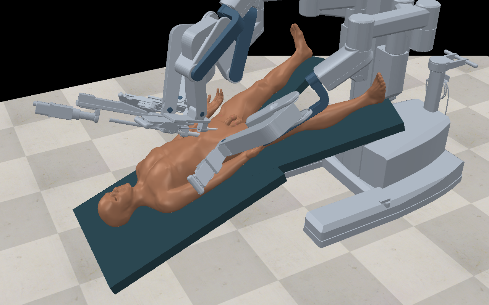

| 机械臂 | 任务角色 | 装配器械（da Vinci Si 8 mm EndoWrist） | 几何认证能力（Geometry-Verified Capabilities） |
|---|---|---|---|
| **PSM1** | 主牵拉 (`retract_primary`) | `420172` Maryland Bipolar Forceps | `grasp`, `grasp_tissue`, `retract_tissue`, `bipolar_energy`, `blunt_dissection` |
| **PSM2** | 切割 (`cut`) | `420179` Monopolar Curved Scissors | `cut`, `monopolar_energy`, `blunt_dissection` |
| **PSM3** | 辅助牵拉与交接 (`retract_assist`) | `420093` ProGrasp Forceps | `grasp`, `grasp_tissue`, `retract_tissue` |
| **ECM** | 内窥镜视野保持 (`view`) | 30° 斜视内窥镜（工作位 70° 1280×960 / 复核位 20° 2560×1920） | `view` |

---

## 工程工作量与项目演进

在 `59+` 次递进提交中，项目从零构建了完整的几何建模、运动学安全控制、任务状态机、双尺度光学闭环与深度学习感知工程体系：

| 工程维度 | 仓库实测规模 | 说明与代表资产 |
|---|---|---|
| **核心源代码规模** | **63,371 行** | **`405` 个 Python 脚本（`60,393` 行）** 覆盖 8 大子目录 + **`25` 个 Lua 脚本（`2,978` 行）**，其中 `src/` 下 `23` 个场景内嵌 Lua 模块 `2,869` 行 |
| **仿真场景与资产** | **5 个自包含场景（`72.4 MB`）** | 5 个递进式 `.ttt` 场景，含同步 URDF、dVRK Si 器械/套管网格与 BodyParts3D 人体解剖模型 |
| **预注册协议与实证** | **175 份协议 + 809 份报告** | `config/` 下 175 份 JSON 协议配置；`validation/` 与 `docs/` 共保存 809 份 JSON 报告、20 份专题技术文档与 `664` 张过程诊断图 |
| **自动化安全回归** | **513 项全通过（0 失败 / 0 跳过）** | 横跨 `54` 个测试脚本；通过 `lua.dll` 直接运行控制器原码，并包含 `nodes_sha256` 轨迹确定性与真值隔离审计 |
| **RGB-D 数据与训练** | **300 轨迹 / 35,046 帧（51.1 GB）** | 4 进程并行 CoppeliaSim 采集（`15,086 帧/小时`），支撑离线 U-Net 切缝分割与 40 轨迹独立尖端确认 |


<details>
<summary>查看 5 个演进场景详细清单</summary>

| 场景文件 | 体积 | 核心增量与里程碑定位 | 参考媒体 |
|---|---:|---|---|
| [`scenes/davinci_three_arm_rcm.ttt`](scenes/davinci_three_arm_rcm.ttt) | 8.42 MB | 无人体三臂软件 RCM 求解与四视图漂移验证 | [三臂 RCM 演示](docs/three_arm_rcm_demo.mp4) |
| [`scenes/davinci_foot_docking_rcm.ttt`](scenes/davinci_foot_docking_rcm.ttt) | 14.87 MB | 脚端中央对接、20° 头低脚高分腿体位、腹壁 RCM 与 2,046 对网格碰撞预检 | [24 秒双视图演示](docs/foot_docking_rcm_demo.mp4) |
| [`scenes/davinci_endoscope_task.ttt`](scenes/davinci_endoscope_task.ttt) | 15.02 MB | 接入 ECM 软件 RCM、30° 斜视内窥镜相机与 PBVS 拾取放置闭环 | [视觉伺服视角](validation/endoscope/endoscope_view.png) |
| [`scenes/davinci_si_instruments.ttt`](scenes/davinci_si_instruments.ttt) | 16.90 MB | 换装 dVRK Si 器械与套管、RBF 气腹穹顶、多约束穿刺点优化与 PBD 组织模型 | [器械与套管布局](docs/ports_si_instruments.png) |
| [`scenes/davinci_si_articulated_verified.ttt`](scenes/davinci_si_articulated_verified.ttt) | 17.22 MB | **当前主场景**：串联独立 `wrist_yaw` 4-DOF 腕部、6-DOF `tool_pose` 控制与全量 P0 安全护栏 | [腕部验证报告](validation/safety/articulation_verified.json) |

</details>

---

## 系统架构

系统严格分离**底层动力学与安全控制**、**世界抽象与真值边界**、**双尺度感知与学习**和**任务状态机决策**四层职责，并通过 `GroundTruth` 用途标签与确定性哈希校验保证所有视觉控制实验“零作弊”。

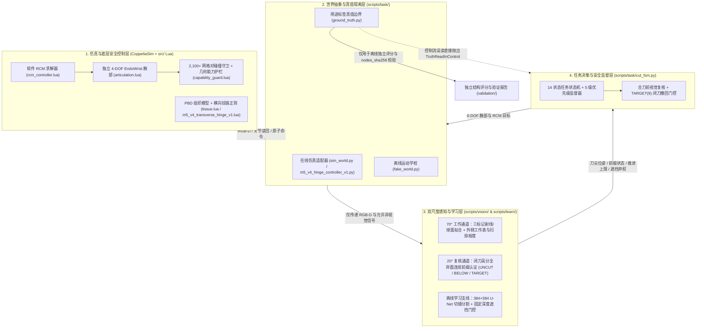

- **真值强制隔离（`scripts/task/ground_truth.py`）**：所有仿真真值（组织节点、内部约束状态）必须附带明确用途标签（`score` / `safety_monitor` / `truth_control`）；当 `control_source = vision` 时任何控制代码试图读取真值都会直接触发 `TruthReadInControl` 异常并中止。
- **双世界镜像与确定性重放**：同一套 `CutTaskFSM` 逻辑可无缝运行于高保真 CoppeliaSim（`sim_world.py`）和毫秒级离线测试桩（`fake_world.py`）；通过固定种子与 `nodes_sha256` 节点哈希审计，扰动注入前的公共工作帧在多条轨迹间逐比特一致，确保归因严格可复现。

---

## 核心工程模块

### 3.1 软件 RCM、6-DOF EndoWrist 腕部与几何能力护栏

1. **高精度软件 RCM 与 2,100+ 对网格碰撞保护**
   - 3 条 PSM 与 1 条 ECM 均通过软件 RCM 约束器械杆穿过固定腹壁穿刺点。在 24 秒（481 控制步）连续演示中，RCM 数值残差 **`< 2×10⁻⁹ m`**，IK 求解失败 `0` 次，碰撞回退 `0` 次。
   - 候选指令提交前对约 **2,100 对网格**（含人体器官、骨骼、手术台、邻臂与套管）进行表面相交检查，仅豁免器械杆在穿刺点 45 mm 半径内的斜向腹壁穿越；任何越界或碰撞立即原子拒绝并回滚状态。
2. **独立 4-DOF EndoWrist 串联关节升级（P0 + M2a）**
   - 针对旧场景缺少独立 `wrist yaw` 自由度的问题，在 `davinci_si_articulated_verified.ttt` 中为三条 PSM 显式串联 `<arm>_wrist_yaw_joint`，独立解耦 `roll`、`wrist pitch`、`wrist yaw` 与 `jaw opening`，使默认切割对准升级为 **6-DOF 器械位姿控制（`cut.align_mode = tool_pose`）**。
   - 腕部指令按 `≤ 0.02 rad` 步长做逐增量碰撞预检与失败恢复（[腕部验证报告](validation/safety/articulation_verified.json) · [运动学与安全记录](docs/SI_KINEMATICS_AND_SAFETY_zh.md)）。
3. **基于 dVRK 网格实测的两处关键运动学修正**
   - **弯剪转轴修正（420179）**：[`scripts/build/measure_jaw_pivot.py`](scripts/build/measure_jaw_pivot.py) 从刀片网格提取共用销孔位于 dVRK 局部 `y = 2.45 mm`，修正原 xacro 绕 `y = 0` 旋转导致张开 1 rad 时销孔错开 `2.4 mm` 的结构失真。
   - **ProGrasp 联动铰点（420093）**：新增从属棱柱关节 `psm3_jaw_hinge_slide`，随总开口角度按 `-2.1 mm/rad` 线性后移（限 `0–60°`）。
4. **只看几何、不信标签的器械能力护栏**
   - [`scripts/build/instrument_guard.py`](scripts/build/instrument_guard.py) 直接比对场景钳口与腕部表面网格和候选 dVRK 模型的平均距离（阈值 `0.5 mm`，实测与次候选间距 `0.68–1.40 mm`），再由 [`src/instruments/capability_guard.lua`](src/instruments/capability_guard.lua) 放行权限——在旧持针钳场景运行时三条 PSM 全被拒绝；剪刀调用抓持、抓钳调用剪切均被运行时拦截。

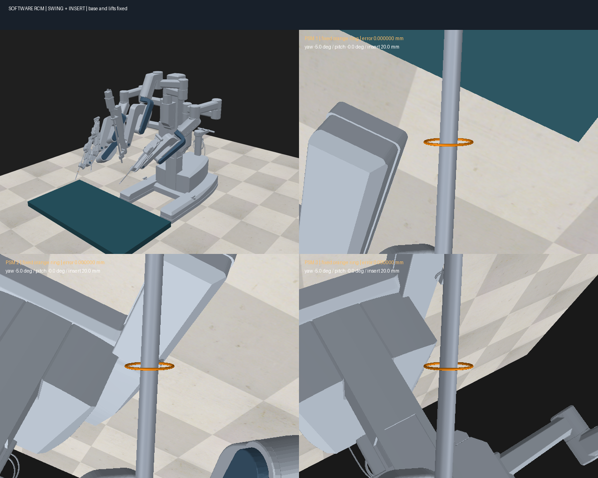

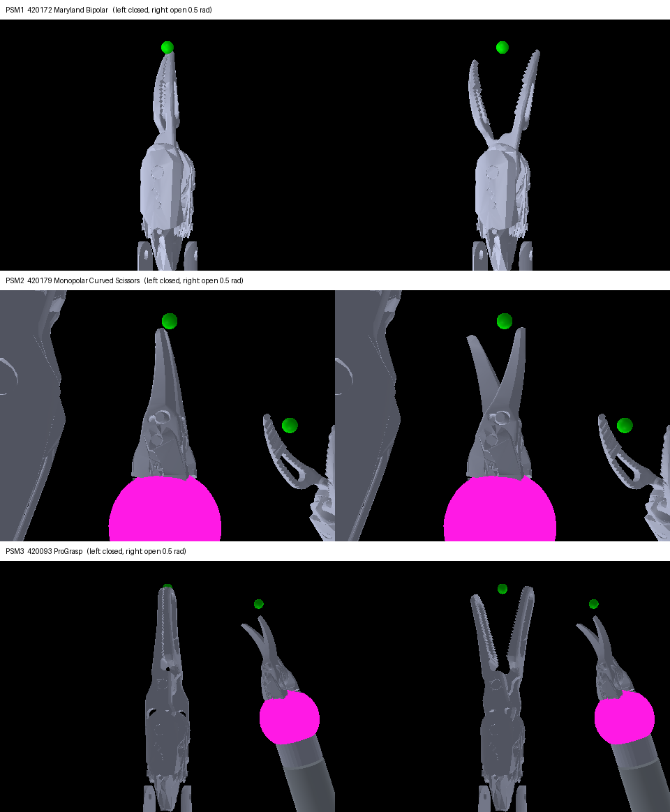

### 3.2 穿刺点多约束重规划、dVRK Si 套管与气腹穹顶建模

针对原始穿刺点下 PSM1 需摆角 `7.3°`（超出 `±1°` 演示窗）的问题，项目通过 [`scripts/build/plan_psm_ports.py`](scripts/build/plan_psm_ports.py) 与 [`scripts/build/access.py`](scripts/build/access.py) 完成了穿刺点优化与解剖通道建模（配置：[`port_plan.json`](config/instruments/port_plan.json) · [`access.json`](config/instruments/access.json)）：

- **体表多约束穿刺点搜索**：在体表网格 6 mm 间隔点上联合求解 PSM1/PSM3 新穿刺点与零空间无碰撞臂姿，强制满足：穿刺点间距 `≥ 60 mm`、与 PSM2 杆夹角 `25–80°`、不挡内窥镜视线（`≥ 7 mm`）、6 mm 柱体走廊不碰骨骼/器官、工作动作包络无意外接触。最终 **PSM1 移动 `2.3 mm`**（至抓点 `127 mm`，夹角 `62°`），**PSM3 移动 `23.4 mm`**（至抓点 `148 mm`，夹角 `31°`）。
- **dVRK Si 套管与 RBF 气腹穹顶**：装配 dVRK Si 8 mm 套管（内径 `8.7 mm`、外径 `12.7 mm`、管长 `125 mm`，RCM 环距管顶 `95 mm`，新增 `226` 对套管碰撞检查），并以径向基函数（RBF）将腹壁皮肤平滑抬升最高 **`22.5 mm`** 成气腹穹顶，同时生成腹膜内表面使各 RCM 点位于皮肤下 `13.5–15 mm`。

| 通路与气腹安全核验项目 | 实测结果 |
|---|---|
| 腹膜与内脏、骨骼表面相交 | **0** |
| 家位全机碰撞（钳口闭合 / 张开 1.0 rad） | **0 / 0** |
| 器械杆穿壁接触区距 RCM 点 | **26–32 mm**（低于 45 mm 穿刺点豁免半径） |
| 24 秒连续演示求解失败 / 碰撞回退 | **0 / 0** |

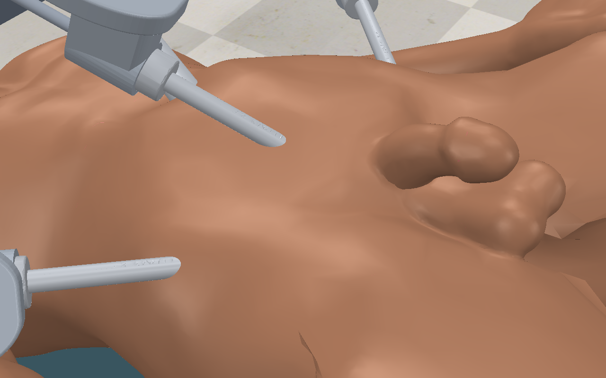

### 3.3 PBD 可变形可剪切组织与横向铰链弯曲正则

组织测试片在 [`src/tissue/tissue.lua`](src/tissue/tissue.lua) 中采用基于位置动力学（PBD）的节点与距离约束网络，每步动态重建三角面片以支持内窥镜真实深度与色彩观测；在此基础上，[`src/tissue/m5_v4_transverse_hinge_v1.lua`](src/tissue/m5_v4_transverse_hinge_v1.lua) 引入横向共享边有向体积投影，抑制牵拉加载时奇偶三角面交替起皱造成的近端自遮挡。

| 物理机制与正则规则 | 触发条件与约束 | 验证指标 |
|---|---|---|
| **组织抓持 (`tissueGrasp`)** | 器械具备 `grasp_tissue` 能力 | 钳口 `1.5 mm` 邻域节点跟随尖端运动；PSM1 成功抓拉 **84** 个节点（0 撕裂）；PSM2 剪刀请求被拒绝 |
| **楔形扫掠剪切** | 器械具备 `cut` 且刀刃张角 `≥ 0.15 rad` | 依前后实际刃角计算扫掠扇区（步长 `≤ 0.05 rad`）剪断约束；PSM2 四次开合剪断 **66** 个约束、切深 **10 mm**；抓钳开合剪断 **0** 个 |
| **过载撕裂保护** | 任意仿真步 | 任一距离约束拉伸至 **`1.5×`** 静息长度即断裂并记录撕裂（tear）；基线测试撕裂 **0** |
| **横向铰链弯曲正则** | 共享横向未切断边的邻接面 | 加载未切时奇偶法向位移 RMS 从 `0.126758 mm` 降至 **`0.000799 mm`**；保留全部 `1,219` 条原始约束，半切即解除本地铰链且断后两岸零耦合（[对照报告](docs/M5_V4_BEND_PAIR_V1.md)） |


### 3.4 14 状态安全监督任务状态机 (`scripts/task/cut_fsm.py`)

任务控制核心由 **14 状态分层状态机** 与 **每拍 5 级优先级安全监督器** 构成，覆盖正常作业流与遮挡、失抓、张力失配、视野偏移等全套异常恢复路径：

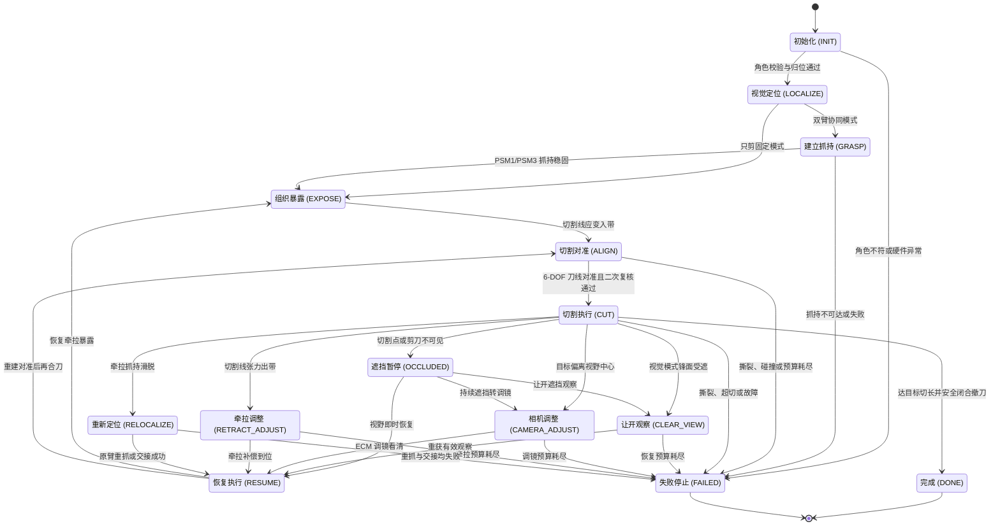

- **5 级监督优先级（每拍检测）**：`① 故障/RCM 漂移 > 0.5 mm/撕裂 → FAILED` > `② 切点或剪刀不可见 → OCCLUDED/CLEAR_VIEW` > `③ 抓持丢失 → RELOCALIZE（原臂重抓或 PSM3 接手）` > `④ 切割线中位应变出带 → RETRACT_ADJUST` > `⑤ 视野偏心 → CAMERA_ADJUST`。合刀前强制再检一次，任何中断恢复后一律先回 `ALIGN` 重新对准再合刀。
- **离线完备性与实机基线**：
  - 离线测试（`scripts/task/test_cut_fsm.py`）：**`28` 个测试场景到达全部 `14/14` 状态、覆盖 `34` 种状态转移**（[覆盖报告](validation/safety/fsm_unit_coverage_m5_v4_hinge_closed_loop_v3_final.json)）。
  - CoppeliaSim 真值控制演示（非 M5 视觉验收）：三臂协同在正常、短暂遮挡、持续遮挡（ECM 转 `3°` 绕开灰球）与滑脱重抓下均稳定完成 `10 mm` 切割（`0` 撕裂，17 拍 `nodes_sha256` 轨迹跨次完全一致）。在 `slip_handover` 工况下，因当前穿刺布置导致 PSM2/PSM3 近端连杆几何碰撞、对侧交接机械不可行，状态机诚实判停为 `FAILED`。


---

## 视觉伺服、M5-v4 闭环突破与深度学习感知

### 4.1 基础视觉伺服：内窥镜引导 PBVS 拾取放置

在 [`scenes/davinci_endoscope_task.ttt`](scenes/davinci_endoscope_task.ttt) 上，[`scripts/vision/visual_servo_task.py`](scripts/vision/visual_servo_task.py) 仅读取内窥镜 RGB-D 与相机内参（颜色分割 + 球面/圆环几何拟合 + 相机系 PBVS 积分控制），完成全流程自主拾取放置：
- **6/6 测试全部成功**（1 次标称 + 5 次注入 `2° + 3 mm` 相机位姿标定误差及 `σ = 0.5 mm` 深度噪声），珠子到目标环中心真值误差 **`0.18–0.58 mm`**，指令拒绝与意外接触均为 `0`，PSM2 RCM 残差 `< 10⁻⁷ m`（[验证汇总](validation/endoscope/visual_task_summary.json)）。


### 4.2 里程碑突破：M5-v4 双尺度视觉闭环 5/5 全工况自主停刀与撤回

**核心任务定义**：从完全未切状态出发，每一步决策严格仅由实时 RGB-D 驱动（`GroundTruth` 严格隔离，绝不读取结构切长、绝不数刀数、绝不放宽 10 mm 损伤红线或碰撞包络），要求机器人在实际结构切长达到 **9 mm** 时由光学信号自主判停并闭刀安全撤回原 `ready pose`。

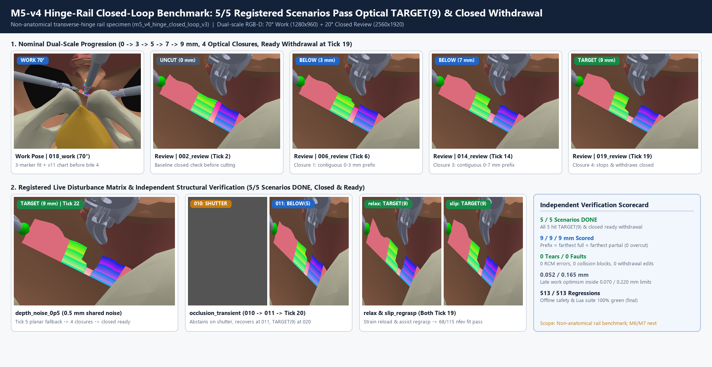

#### 双尺度协同闭环架构（`m5_v4_hinge_closed_loop_v3`）

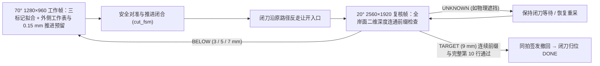

#### 五工况全新场景一次实跑矩阵（无重试、无回退调参）

全部 5 个工况均在冻结控制器后、各用全新 CoppeliaSim 实例一次实跑通过（[协议](config/task/m5_v4_hinge_closed_loop_v3.json) · [矩阵判定](validation/task/m5_v4_hinge_closed_loop_v3/matrix.json) · [详报](docs/M5_V4_HINGE_CLOSED_LOOP_V3.md)）：

| 预注册实跑工况 | 光学闭剪序列与核心实证 | 终态帧 | 结构评分（前缀 / 最远完整 / 最远局部） | 撕裂 / 碰撞 / 撤回损伤 | 闭刀归位 `ready` |
|---|---|---:|---:|---:|---|
| **`nominal`（标称）** | `BELOW(3, 5, 7)` → `TARGET(9)`；全程无需平面回退 | `019_review` (tick 19) | **9 / 9 / 9 mm** | 0 / 0 / 0 | **通过 (`DONE`)** |
| **`depth_noise_0p5`（0.5 mm 深度噪声）** | 共享测量噪声；tick 5 触发唯一一次早段平面回退，4 次闭剪达 `TARGET(9)` | `022_review` (tick 22) | **9 / 9 / 9 mm** | 0 / 0 / 0 | **通过 (`DONE`)** |
| **`occlusion_transient`（物理挡板遮挡）** | 真实非碰撞挡板遮挡；tick 10 诚实判 `UNKNOWN` 闭刀停等，tick 11 撤挡重获 `BELOW(5)` → `TARGET(9)` | `020_review` (tick 20) | **9 / 9 / 9 mm** | 0 / 0 / 0 | **通过 (`DONE`)** |
| **`relax`（牵拉张力松弛）** | 模型应变 `0.11424 → 0.09999 → 0.11418` 失效重查并补拉；开刀第 18 拍远端标记 68 次评估收敛 → `TARGET(9)` | `019_review` (tick 19) | **9 / 9 / 9 mm** | 0 / 0 / 0 | **通过 (`DONE`)** |
| **`slip_regrasp`（辅助臂抓持滑脱重抓）** | 辅助抓持节点 `10 → 0 → 9` 失效重抓；开刀第 13 拍近端标记 115 次评估收敛 → `TARGET(9)` | `019_review` (tick 19) | **9 / 9 / 9 mm** | 0 / 0 / 0 | **通过 (`DONE`)** |

#### 从“单视角卡在 7.72 mm”到“M5-v4 5/5 通关”的科研归因链

为了严谨定位视觉停刀障碍，项目没有靠“调宽阈值”蒙混过关，而是完成了四步可证伪的因果实验：
1. **悬空试样瓶颈归因**：早期 `Active-Look` 在标称工况虽已切到 9 mm，单目工作读数仅 `7.72 mm`（最高 `8.54 mm`），控制器安全拒签撤刀（[实跑记录](docs/M5_LIVE_DEVELOPMENT.md)）；`cell_certificate_v2` 对照证实 `20°` 闭刀微退回看能准确读出 `8 / 9 / 10 mm` 局部前沿，而 `70° 1280×960` 广角终段角标仅占 ≤ 1 个可辨像素（[20° vs 70° 对照](docs/M5_ENDPOINT.md)）。
2. **横向铰链消除奇偶褶皱遮挡**：配对实验 [`m5_v4_bend_pair_v1`](docs/M5_V4_BEND_PAIR_V1.md) 证实横向体积正则将奇偶面法向折叠 RMS 从 `0.126758 mm` 压至 `0.000799 mm`，第 6–10 行最弱有效岸面像素由 `965 px` 增至 `3,362 px`。
3. **斜平面深度校准归因与工作裕度锁死**：[`m5_v4_plane_blind_v2`](docs/M5_V4_PLANE_BLIND_V2.md) 通过 12 个独立盲测位姿揭示渲染深度在 60° 倾斜时沿倒数深度梯度偏移约半像素（前向模型将 P95 误差从 `0.20604 mm` 压至 `0.00122 mm`），解释了远端工作估距普遍乐观 `+0.20 mm` 的成因；据此冻结 `0.070 + 0.3σ mm`（即原生 `0.070` / 噪声 `0.220 mm`）的纵向乐观包络与 `0.150 mm` 推进预留——`v3` 新增晚段实测上限 **`0.05162 mm`（原生 3/3）** 与 **`0.16465 mm`（加噪 36/36）** 全部落在门限内。
4. **v1 → v2 → v3 预注册收敛**：[`v1`](docs/M5_V4_HINGE_CLOSED_LOOP_V1.md) 先过 `nominal` 与 `occlusion_transient`（2/5），精准暴露了球面拟合 `max_nfev=60` 截断（`relax` 84 px / `slip` 286 px）与噪声首轴偏斜；[`v2`](docs/M5_V4_HINGE_CLOSED_LOOP_V2.md) 试图改写标记残差，因离线重放超出工作裕度门限按预注册规则整批拒跑；[`v3`](docs/M5_V4_HINGE_CLOSED_LOOP_V3.md) 保持原残差及历史有效姿态逐比特一致（203/203 刀尖与 208/208 工作表零漂移），仅将迭代上限放宽至 `200` 并限制早段 `0..5` 平面回退，最终实现 **5/5 一次实跑全过**。

<details>
<summary>历史演进对比：早期悬空试样（Active-Look / cell_certificate v2 / two_bite_v1）保留证据</summary>

| 早期视觉基准 | 核心观察与保留价值 | 代表报告与图 |
|---|---|---|
| **悬空试样 `Active-Look`** | 标称 0→3→5→9 mm（第 3 刀后光学读数 7.72 mm 停刀拒签），噪声 8 mm、遮挡 5 mm、松弛 6 mm | [五工况记录](validation/task/m5_live_active_look_v1/five_scenarios.json) · [标称轨迹图](validation/task/m5_live_active_look_v1/nominal_live.png) |
| **`cell_certificate v2`（20° vs 70°）** | 20° 闭刀微退首次在原始/加噪下全读对 8/9/10 mm 局部前沿；揭示 70° 广角单像素中心不足瓶颈 | [20° 回看对照图](validation/task/cell_certificate_v2_dev/working_vs_look.png) · [70° 广角判定](validation/task/cell_certificate_v2_hd_dev/decision.json) |
| **「两刀视觉闭环」（`two_bite_v1`）** | 独立归档基线：标称与噪声均完成 3+2 mm 增长并安全收刀，全遮挡 0 mm 拒剪 | [两刀协议](config/task/two_bite_v1.json) · [配对试跑协议](config/task/two_bite_pair_v1.json) |

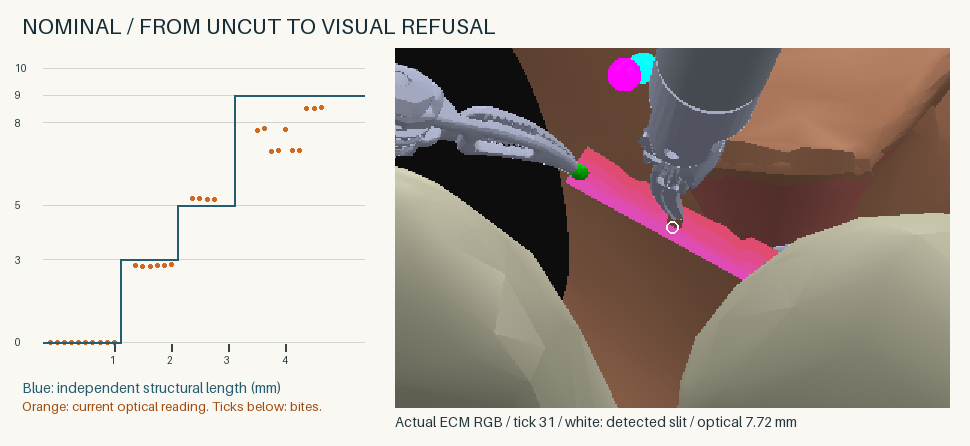

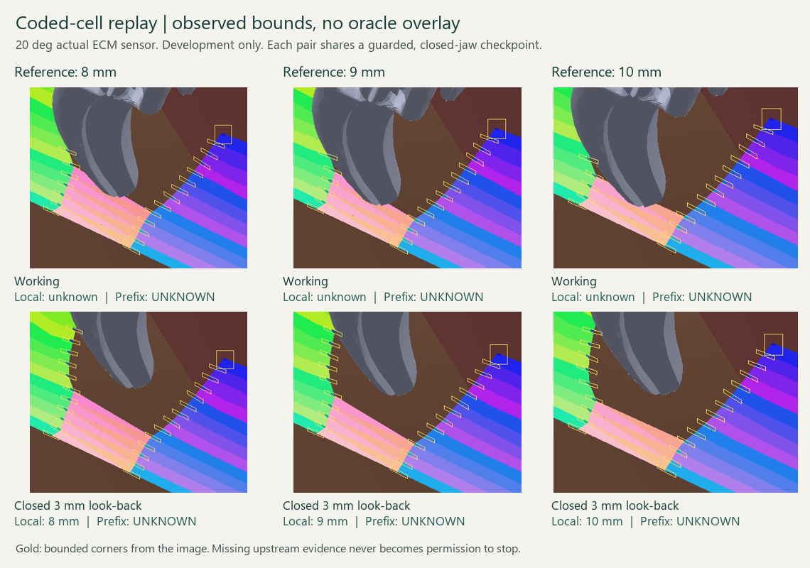

</details>

### 4.3 Phase A 多视角 RGB-D 数据管道与深度学习感知支线

为服务无编码纹理与强遮挡场景，项目同步构建了高吞吐离线 RGB-D 数据管道及两个已冻结结论的感知子模块：

1. **高吞吐并行 RGB-D 数据集（Phase A 完成）**：
   - [`scripts/learn/collect.py`](scripts/learn/collect.py) 调度 **4 个并行 CoppeliaSim Worker**，以 **`15,086 帧/小时`** 的吞吐率在 2.32 小时内采集 **`300` 条开发轨迹 / `35,046` 帧（`51.1 GB`）**，包含主相机、4 路 RCM 辅助视角及同位姿 **`1280×960` 原生高清双生帧**；248 条完成、52 条失败轨迹全部保留不剔除（[采集报告](validation/task/learned_perception_v1/dev.json)）。
   - 验证了端到端图像分类在高清首次入区间（0/18 与 0/12）上的不可靠性，据此将深度学习感知聚焦于**可见切缝分割**与**尖端遮挡判别**。

2. **子任务 A：可见切缝 RGB-D U-Net 分割（首轮 6 轮训练完成）**


- 按轨迹（非按帧）划分 **270 条训练（5,273 帧）/ 30 条开发验证（568 帧）**；单张 RTX 4060 Laptop GPU 训练 6 轮约 **9.3 分钟**（峰值显存 **1.64 GiB**，平均批次损失由 `0.075210` 降至 `0.000806`）。
- 在开发集有标签区域上（[训练报告](docs/VISIBLE_SLIT_TRAINING_zh.md) · [JSON 报告](validation/task/learned_perception_v1/visible_slit_weak_v1/report.json)）：切缝弱标签召回率 **`3,596 / 3,596`（100%）**，已知背景误报 `1,001` 像素，有标签精确率 / IoU **`78.2% / 78.2%`**（未知区域预测 `22,085` 像素不计对错，尚未接入控制闭环）。

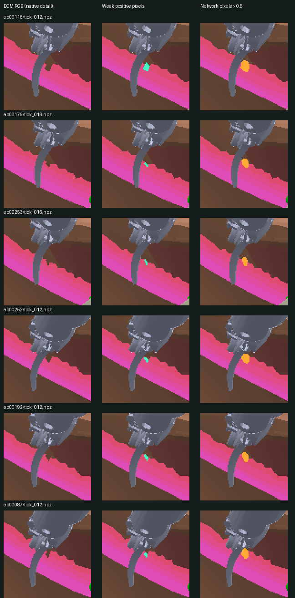

3. **子任务 B：剪刀尖端定位与遮挡弃权（固定深度规则通过独立离线确认）**

在 **`40` 条独立确认轨迹（837 帧：789 帧正常可见 + 48 帧明确深度遮挡）** 上开展对比（[确认报告](validation/task/learned_perception_v1/tip_training_v1/marker_gate_confirmation_report.json) · [门控对比](validation/task/learned_perception_v1/tip_training_v1/marker_gate_dev_report.json)）：

| 尖端定位方案 | 评估集与深度条件 | 正例覆盖率 | 3D 误差中位数 / P95 | `> 2 mm` 大误差占比 | 明确遮挡帧误接受率 | 结论 |
|---|---|---:|---:|---:|---:|---|
| **端到端学习尖端模型** | 开发集 568 帧（原始 / 0.5 mm 噪声） | 38.1% / 38.1% | 0.60 / 2.70 mm · 0.61 / 2.67 mm | 10.8% | **0 / 9** | 未达开发门槛 |
| **基线三标记 Kabsch** | 独立确认 837 帧（原始 / 0.5 mm 噪声） | 96.5% / 95.6% | 0.29 / 0.45 mm · 0.42 / 0.95 mm | 0.0% | **48 / 48** · **46 / 48** | 遮挡必误报 |
| **三标记 Kabsch + 固定深度弃权** | 独立确认 837 帧（原始 / 0.5 mm 噪声） | **96.5% / 95.6%** | **0.29 / 0.45 mm · 0.42 / 0.95 mm** | **0.0%** | **0 / 48 (0.0%)** | **独立确认全过** |

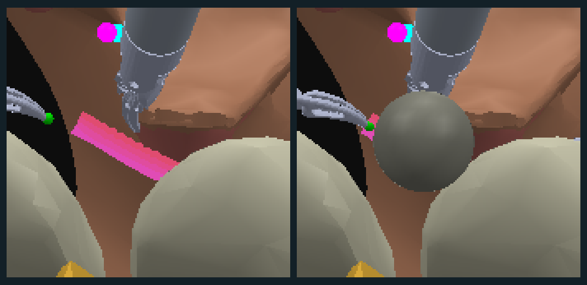

---

## 里程碑看板与科研边界

### 项目里程碑状态总览

| 里程碑 | 内容与目标 | 当前状态 | 关键指标 / 证据 |
|---|---|---|---|
| **M1 / M2a / M2b** | 基础加固、6-DOF 腕部控制 (`tool_pose`)、腕部可达性 | **已完成** | `davinci_si_articulated_verified.ttt`；RCM 残差 `< 2×10⁻⁹ m`；513 项回归全过 |
| **M3** | 前列腺邻近解剖定位可行性研究 | **阻塞（已严谨证伪）** | 见下方可达性分析与 [开发路线图](docs/DEVELOPMENT_ROADMAP_zh.md) |
| **M4** | 影子视觉感知与传感器退化基准 | **已完成** | 零副作用全帧导出；深度噪声与位姿扰动退化曲线 |
| **M5a / M5b（原无正则试样）** | 原悬空/无铰链测试片单视角停刀研究 | **归档保留（未验收）** | 真值基线 10 mm 可复现；`Active-Look` 达 9 mm（读 7.72 mm 安全拒签） |
| **M5-v4 导轨基准** | 横向铰链导轨试样全流程视觉闭环停刀与闭刀撤回 | **注册矩阵 5/5 全通过** | [`completion.json`](validation/task/m5_v4_hinge_closed_loop_v3/completion.json) · [实跑矩阵](validation/task/m5_v4_hinge_closed_loop_v3/matrix.json) |
| **Phase A 学习感知** | 35,046 帧 RGB-D 数据集、切缝 U-Net 与尖端遮挡门控 | **阶段完成** | 切缝弱标签 IoU 78.2%；三标记固定深度规则通过 40 轨迹独立确认 |
| **M6（当前主攻）** | 基于视觉张力代理的自适应牵拉与 ECM 主动视野协同 | **待开展** | 承接 M5-v4 闭环底座，攻克 `relax_large` 与连续主动视野追踪 |
| **M7（当前主攻）** | 多种子配对 2×2 消融评估（固定 vs 视野 vs 牵拉 vs 联合） | **待开展** | 实验对照设计与护栏已预写入 [开发路线图](docs/DEVELOPMENT_ROADMAP_zh.md) |

> **M5-v4 检查点归档说明**：仓库保存了 M5-v4 的冻结源码、协议、前置依赖、`v1/v2/v3` 决策矩阵、实跑 `.npz` 图像序列与 `513` 项最终回归报告。核查可从 [`completion.json`](validation/task/m5_v4_hinge_closed_loop_v3/completion.json) 的 SHA-256 校验链逐层追溯至各工况 [`decision.json`](validation/task/m5_v4_hinge_closed_loop_v3/nominal/decision.json)。

### 代表性负向研究发现：M3 前列腺邻近定位可达性证伪

面对“多臂是否真的能从当前体位与穿刺点在不删除膀胱的前提下安全到达前列腺侧方切口”这一关键问题，项目拒绝“删掉遮挡器官凑结果”的做法，在 `validation/feasibility/` 中先后完成 3 版递进几何可行性扫描：
1. **保留膀胱且计入腕部弯折**：8 个前列腺侧方目标中 **0 / 8** 可同时实现三臂安全到达（[`prostate_access_wrist.json`](validation/feasibility/prostate_access_wrist.json)）。
2. **预设膀胱刚体牵开（0–60 mm）**：即使放宽至外推 60 mm 牵开，在纳入器械间距 `≥ 12 mm`、穿刺点 `±2°` 摆动与代理切口动作行程（v2/v3 协议）后，**25–60 mm 仍全组不可行**，瓶颈源于剪刀无法走完整段切口行程（[`bladder_retraction.json`](validation/feasibility/bladder_retraction.json)）。
3. **学术诚实原则**：据此团队将 M3 正式标记为 `blocked`，坚持在非解剖 PBD 测试片上诚实开展 M5–M7 感知—控制基础研究，绝不把当前成果夸大为“前列腺筋膜切割”或“神经血管束（NVB）保护”。

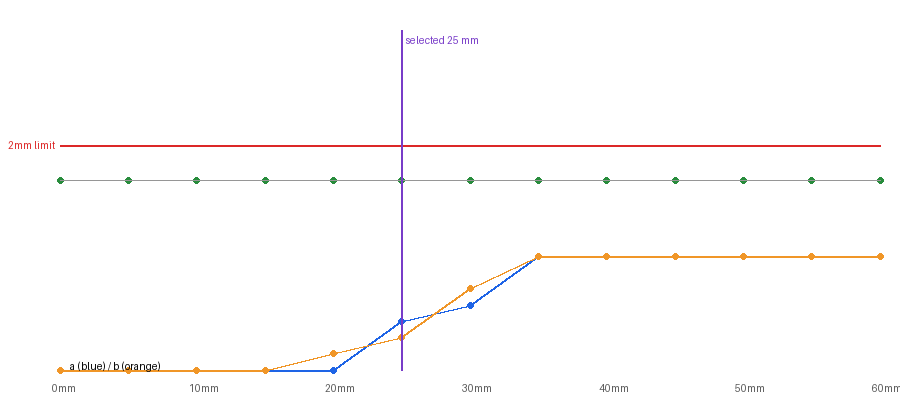

### 预注册工程纪律与已知模型局限

- **科研纪律**：先预注册协议（与源文件哈希绑定）再采集与评估；绝不放宽碰撞包络、关节限位、误差门槛或恢复预算；留出集一旦审阅失败即降级开发集永不复用；历史报告原地封存，新版本另行落盘。
- **已知仿真边界**：
  1. 软件 RCM 采用 CAD 等效串联运动学链，未标定真机闭链机械耦合、绳驱回差与厂商限位。
  2. PBD 组织与横向铰链正则均为无质量、无重力、无出血、无器械接触力的纯运动学模型；PBD 应变是模型几何量，不等于临床测力。
  3. 解剖人体为静态刚体网格，无呼吸运动或器官软组织随牵拉形变；气腹仅抬高体表穹顶并生成腹膜，未仿真腹压导致的器官下沉。
  4. 场景内窥镜 CAD 杆径 14–20 mm，故 ECM 套管内径设为 20.8 mm，粗于临床 Si 12 mm 内窥镜。
  5. 能量器械（单极电凝/双极止血）电热效应未予仿真。

<details>
<summary>查看仓库全部 20 份专题技术文档索引 (docs/*.md)</summary>

| 文档 | 主题与内容说明 |
|---|---|
| [`docs/M5_V4_HINGE_CLOSED_LOOP_V3.md`](docs/M5_V4_HINGE_CLOSED_LOOP_V3.md) | **M5-v4 终版报告**：五工况全新场景闭环全通过记录与撤回评分 |
| [`docs/M5_V4_HINGE_CLOSED_LOOP_V2.md`](docs/M5_V4_HINGE_CLOSED_LOOP_V2.md) | M5-v4 v2 离线否定决策与 2×2 残差—工作表归因分析 |
| [`docs/M5_V4_HINGE_CLOSED_LOOP_V1.md`](docs/M5_V4_HINGE_CLOSED_LOOP_V1.md) | M5-v4 v1 首轮闭环实跑（2/5 通过）与球面拟合截断定位 |
| [`docs/M5_V4_BEND_PAIR_V1.md`](docs/M5_V4_BEND_PAIR_V1.md) | 原试样 vs 横向铰链弯曲正则加载对照（折叠 RMS 降 158 倍） |
| [`docs/M5_V4_BEND_TERMINAL_V1.md`](docs/M5_V4_BEND_TERMINAL_V1.md) | 导轨试样 8/9 mm 终端对比度筛选与宽视野工作裕度检查 |
| [`docs/M5_V4_BEND_RIM_AUDIT_V1.md`](docs/M5_V4_BEND_RIM_AUDIT_V1.md) | 宽视野第 10 行工作估距乐观偏移的多因素逐像素归因审计 |
| [`docs/M5_V4_PLANE_CALIBRATION_V1.md`](docs/M5_V4_PLANE_CALIBRATION_V1.md) | 刚体棋盘斜平面深度随坡度偏移探索与倒数深度假设提出 |
| [`docs/M5_V4_PLANE_BLIND_V2.md`](docs/M5_V4_PLANE_BLIND_V2.md) | 12 位姿刚体斜平面盲测通过（P95 0.0012 mm）及工作迁移判定 |
| [`docs/M5_V4_CENTER_SCREEN_V1.md`](docs/M5_V4_CENTER_SCREEN_V1.md) | 工作位直接观测第 10 行中心角标/三角面的采样密度诊断 |
| [`docs/M5_V4_REVIEW_PROBE_V1.md`](docs/M5_V4_REVIEW_PROBE_V1.md) | M5-v4 首个闭刀备选视角探针实验 |
| [`docs/M5_LEVEL_0_zh.md`](docs/M5_LEVEL_0_zh.md) | 非解剖测试片真值反馈停刀与闭刀撤回机械参考对照 |
| [`docs/M5_TEMPORAL_EVIDENCE_zh.md`](docs/M5_TEMPORAL_EVIDENCE_zh.md) | 逐刀证据、双尺度回看、双侧二维岸面连通与导轨演进全记录 |
| [`docs/M5_ENDPOINT.md`](docs/M5_ENDPOINT.md) | 原 M5 9–10 mm 停刀边界、编码测试片对比与光学限制说明 |
| [`docs/M5_LIVE_DEVELOPMENT.md`](docs/M5_LIVE_DEVELOPMENT.md) | Same-Bite 与 Active-Look 五工况历史实跑记录与复现命令 |
| [`docs/M5_ROW9_CONTACT_DEV_V1.md`](docs/M5_ROW9_CONTACT_DEV_V1.md) | 第 9 行终端接触视觉线索开发诊断（非停刀许可） |
| [`docs/M5_VISIBLE_FRACTURE_DEV_V1.md`](docs/M5_VISIBLE_FRACTURE_DEV_V1.md) | 可见裂口形态检测开发实验（非验收） |
| [`docs/VISIBLE_SLIT_TRAINING_zh.md`](docs/VISIBLE_SLIT_TRAINING_zh.md) | Phase A 同位姿高清 RGB-D 弱标签切缝分割 U-Net 训练细节与复现命令 |
| [`docs/SI_KINEMATICS_AND_SAFETY_zh.md`](docs/SI_KINEMATICS_AND_SAFETY_zh.md) | 独立 `wrist_yaw` 4-DOF EndoWrist 升级、P0 安全护栏与 FK 校验细节 |
| [`docs/DEVELOPMENT_ROADMAP_zh.md`](docs/DEVELOPMENT_ROADMAP_zh.md) | P0→P4 分阶段路线图、BodyParts3D 资产审计流程、M3 阻塞依据与 M7 对照设计 |
| [`docs/DETAILS_zh.md`](docs/DETAILS_zh.md) | 脚端对接、内窥镜 PBVS 场景、Si 换装及穿刺点规划早期完整技术笔记 |

</details>

---

## 快速开始与复现

### 1. 零依赖场景预览（无需 Python）

使用 **CoppeliaSim Edu 4.10** 直接打开 [`scenes/davinci_si_articulated_verified.ttt`](scenes/davinci_si_articulated_verified.ttt) 并点击播放即可演示。场景内已嵌入全部网格与 Lua RCM / 腕部控制器，右侧 UI 面板支持交互切换臂号、调节 `yaw / pitch / insertion / grip` 及切换人体解剖透视层。

### 2. 离线自动化回归测试（513 项，无需启动 CoppeliaSim）

```powershell
python -m pip install -r requirements-build.txt
python scripts/tests/run_regressions.py --out validation/safety/my_regressions.json
```

> [!NOTE]
> 在 Windows 上该套件会自动加载 CoppeliaSim 安装目录的 `lua.dll` 实际执行原版 Lua 控制器源码；PowerShell 若因 stderr 包装返回非零退出码，请以输出中的 `OK` 及生成报告的 `"success": true` 为准。

### 3. M5-v4 闭环复现与在线 CoppeliaSim 任务运行（Windows PowerShell）

```powershell
# A. 离线复核 M5-v4 v3 已登记封存与全量回归门限（无需仿真器）
python scripts/analysis/qualify_m5_v4_hinge_v3.py
python scripts/analysis/report_m5_v4_hinge_matrix_v1.py --help

# B. 启动专用无头 CoppeliaSim 实例（Windows Remote API 须传入纯英文 --stage-dir）
& "C:\Program Files\CoppeliaRobotics\CoppeliaSimEdu\coppeliaSim.exe" -h -GzmqRemoteApi.rpcPort=23170

# C. 运行默认主场景的三臂协同切割基线（支持 --trace 验证确定性哈希）
python scripts/task/run_cut_task.py --port 23170 --stage-dir C:/Temp/sim_stage --mode full --scenario nominal --trace
python scripts/task/run_cut_task.py --port 23170 --stage-dir C:/Temp/sim_stage --mode full --scenario occlusion_persistent

# D. 运行已归档 M5 Active-Look 视觉开发实跑（--out 须为尚不存在的新目录）
python scripts/task/run_active_look.py --case nominal --out validation/task/my_active_look_01 --port 23170 --stage-dir C:/Temp/sim_stage
```

若需从零重跑 `M5-v4 v3` 实机矩阵（`scripts/task/run_m5_v4_hinge_closed_loop_v3.py --case <case> --launch-simulator <coppeliaSim.exe>`），请按 [`config/task/m5_v4_hinge_closed_loop_v3.json`](config/task/m5_v4_hinge_closed_loop_v3.json) 与 [`docs/M5_V4_HINGE_CLOSED_LOOP_V3.md`](docs/M5_V4_HINGE_CLOSED_LOOP_V3.md) 预留新输出目录与专用端口，避免覆盖已有封存结果。

### 4. 离线深度学习训练复现（CUDA）

切缝 U-Net 训练与尖端实验依赖固定于 [`requirements-learn.txt`](requirements-learn.txt)（PyTorch 2.9.1 + CUDA 12.6）。原始 `51.1 GB` RGB-D 帧与 `.pt` 模型权重未入 Git 仓库；制备或指定 Phase A 本地数据索引后，可直接按 [`docs/VISIBLE_SLIT_TRAINING_zh.md`](docs/VISIBLE_SLIT_TRAINING_zh.md) 中的 PowerShell 命令复现弱标签生成与 6 轮训练。

<details>
<summary>展开查看场景从零重建与几何校验脚本命令</summary>

```powershell
cd scripts/build
python fetch_dvrk_instruments.py               # 拉取固定提交 dVRK 器械网格（已入库可跳过）
python fetch_dvrk_cannulas.py                  # 拉取固定提交 dVRK Si 套管（已入库可跳过）
python install_instruments.py --port 23170     # 换装 Si 器械并生成气腹/套管与 port_plan
python plan_psm_ports.py --port 23170          # 可选：重规划 PSM1/PSM3 穿刺点与臂姿
python upgrade_si_articulation.py --port 23170 # 升级至独立 wrist_yaw 并输出 verified 场景与校验报告
python instrument_guard.py --port 23170 --scene ../../scenes/davinci_si_articulated_verified.ttt --out ../../validation/instruments/my_guard_check.json
python ../tissue/tissue_cut_demo.py --port 23170
```

更早期的内窥镜场景（`davinci_endoscope_task.ttt`）重建步骤见 [`docs/DETAILS_zh.md`](docs/DETAILS_zh.md)。

</details>

---

## 仓库目录结构

```text
davinci-multiarm-rcm-simulation/
├── scenes/                        # 5 个递进式自包含 CoppeliaSim 场景（主入口：davinci_si_articulated_verified.ttt）
├── src/                           # 场景内嵌 Lua 控制器与物理模块（23 文件，2,869 行）
│   ├── rcm_*.lua / patient_panel.lua
│   ├── endoscope/                 # ECM 软件 RCM 与相机面板控制
│   ├── instruments/               # 4-DOF 腕部解算与运行时几何能力护栏
│   ├── tissue/                    # PBD 组织节点网格、楔形剪切、横向铰链正则与归档版本
│   └── legacy/                    # 早期三臂演示控制器留档
├── scripts/                       # Python 核心工程代码（405 个 .py 文件，60,393 行）
│   ├── authoring/                 # 18 个文件：脚端对接、分腿体位调整与早期规划工具
│   ├── build/                     # 20 个文件：dVRK 资产拉取、套管/气腹构建、穿刺点规划与腕部升级
│   ├── tissue/                    # 1 个文件：PBD 组织抓拉与剪切独立验证入口
│   ├── task/                      # 99 个文件：14 状态 FSM、真值隔离层、M5-v4 控制器与在线运行器
│   ├── vision/                    # 51 个文件：PBVS 拾取放置、三标记刀尖拟合、双尺度读取器与重放
│   ├── analysis/                  # 132 个文件：M3 可达性扫描、斜平面盲测校准、M5-v4 评分与资产审计
│   ├── learn/                     # 29 个文件：Phase A 多进程 RGB-D 采集、弱标签构造、U-Net 训练与确认
│   └── tests/                     # 54 个文件：离线回归套件（513 项测试，含 lua.dll 实跑与真值隔离测试）
├── config/                        # 175 份 JSON：RCM 参数、2,100+ 碰撞对、器械能力、预注册实验协议
├── models/                        # 机器人 URDF、CAD 网格、dVRK Si 器械/套管、BodyParts3D 解剖模型
├── validation/                    # 809 份 JSON 报告与 642 张过程诊断截图及 M5-v4 实拍 `.npz` 归档
├── docs/                          # 20 份专题技术文档、22 张汇总图及演示视频
├── AGENTS.md                      # 仓库工程规范、开发上下文与科研边界备忘
└── requirements*.txt              # 基础运行、场景构建（requirements-build.txt）与深度学习（requirements-learn.txt）依赖
```

---

## 数据来源与署名

- **解剖模型**：BodyParts3D, © The Database Center for Life Science, licensed under **CC Attribution 4.0 International**（[许可声明](https://dbarchive.biosciencedbc.jp/en/bodyparts3d/lic.html) · [官方下载](https://dbarchive.biosciencedbc.jp/en/bodyparts3d/download.html)）。从官方 `isa_BP3D_4.0_obj_99.zip` 筛选器官与体表模型，完成单位换算、体位调整及分腿姿态处理。
- **器械网格**：[`jhu-dvrk/dvrk_model`](https://github.com/jhu-dvrk/dvrk_model)（MIT License，副本见 [`models/meshes/instrument/dvrk/LICENSE`](models/meshes/instrument/dvrk/LICENSE)）。
- **套管模型**：[`jhu-dvrk/dvrk-cannulas`](https://github.com/jhu-dvrk/dvrk-cannulas)（MIT License，副本见 [`models/meshes/cannula/dvrk/LICENSE`](models/meshes/cannula/dvrk/LICENSE)）。
- **器械关节限位数值**：[`jhu-dvrk/sawIntuitiveResearchKit`](https://github.com/jhu-dvrk/sawIntuitiveResearchKit)（cisst License，仅引用数值参数，未复制源码）。
- **机器人本体 CAD 与原始持针钳**：用户提供之项目资产，许可与上述开源部分独立管理。
