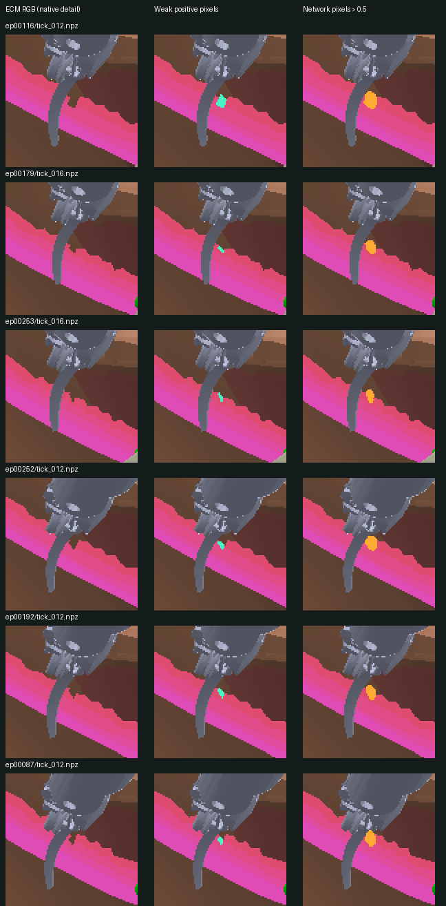

# 可见切缝分割：首轮训练报告

目标是在非解剖仿真测试片的单帧 RGB-D 上输出可见裂口的像素掩码。模型不估计裂缝末端或结构切长，不控制机械臂，不授权闭剪或停刀。

## 数据与标签

| Phase A 按轨迹划分 | 轨迹 | 帧 | 有切缝弱标签的帧 | 切缝弱标签像素 |
|---|---:|---:|---:|---:|
| 训练 | 270 | 5,273 | 1,248 | 34,072 |
| 开发验证 | 30 | 568 | 124 | 3,596 |

- 使用与主相机曝光配对的 1280×960 同位姿高清渲染，固定裁剪 384×384，保留原生像素。没有混入辅助视角或新增采集；失败轨迹留在原划分。
- 网格中缺失的面只生成标签候选。还要求非粉色像素的实测深度位于候选面后方，且裂口两侧有同帧可见试样支撑。遮挡和模糊的区域不当正例，也不强行填成背景。
- 训练输入只有 RGB-D。网格、切长、相机位姿、轨迹状态不进模型。标签是保守的自动弱标注，不是人工描出的完整边界。

[协议](../config/learn/visible_slit_weak_v1.json) · [标签登记](../validation/task/learned_perception_v1/visible_slit_weak_v1/label_registration.json) · [训练登记](../validation/task/learned_perception_v1/visible_slit_weak_v1/training_registration.json)

## 训练与结果

RGB-D U-Net、AdamW、批大小 8、CUDA BF16、固定 6 轮，只用第 6 轮模型报告结果。训练和最后的开发集出图合计约 556.9 秒，RTX 4060 Laptop GPU 峰值显存约 1.64 GiB。

| 轮次 | 1 | 2 | 3 | 4 | 5 | 6 |
|---|---:|---:|---:|---:|---:|---:|
| 平均批次损失 | 0.075210 | 0.014181 | 0.004959 | 0.002466 | 0.001338 | 0.000806 |

固定输出阈值 0.5 下，模型覆盖了 3,596/3,596 个切缝弱标签像素，并误标 1,001 个已知背景像素。在有标签的像素上，精确率和 IoU 均为 78.2%。模型还在 22,085 个未知像素上输出了切缝预测，这些区域没有可用标签，不能判对或错。444 张无切缝正标签的帧中，125 张至少有一个已知背景像素被误标；这些帧不等同于全部未切帧。



图中只展示有正标签的开发帧；预测往往比保守标签宽。**100% 是对当前弱标签像素的覆盖，不是对真实裂缝边界、被挡区域或新场景的召回保证。** 本轮没有独立切缝评估或控制器接入。[完整 JSON 报告](../validation/task/learned_perception_v1/visible_slit_weak_v1/report.json)

## 复现

在仓库根目录运行 PowerShell。需要 [学习环境](../requirements-learn.txt) 及已有 Phase A 数据、配对高清帧和固定索引；Git 不含这些数据、缓存或权重。下列命令只做离线标签生成和训练，不启动 CoppeliaSim。输出目录必须尚不存在。

```powershell
$root = 'F:/davinci_m5_learn/learned_perception_v1'
$cache = "$root/phase_a_slit_masks_repro_01"
$out = "$root/visible_slit_weak_v1_repro_01"
$env:OPENBLAS_NUM_THREADS = '1'
$env:OMP_NUM_THREADS = '1'
& '.\.venv-learn\Scripts\python.exe' 'scripts/learn/build_visible_slit_labels.py' --index "$root/phase_a_pilot_index_v1.json" --out $cache
if ($LASTEXITCODE -ne 0) { throw 'Label construction failed' }
& '.\.venv-learn\Scripts\python.exe' 'scripts/learn/train_visible_slit.py' --cache $cache --out $out
```

结果目录包含 `slit_epoch06.pt`、`report.json`、`training_registration.json` 和 `development_examples.png`。
